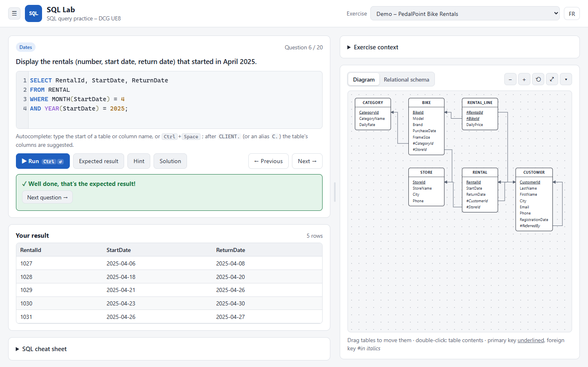
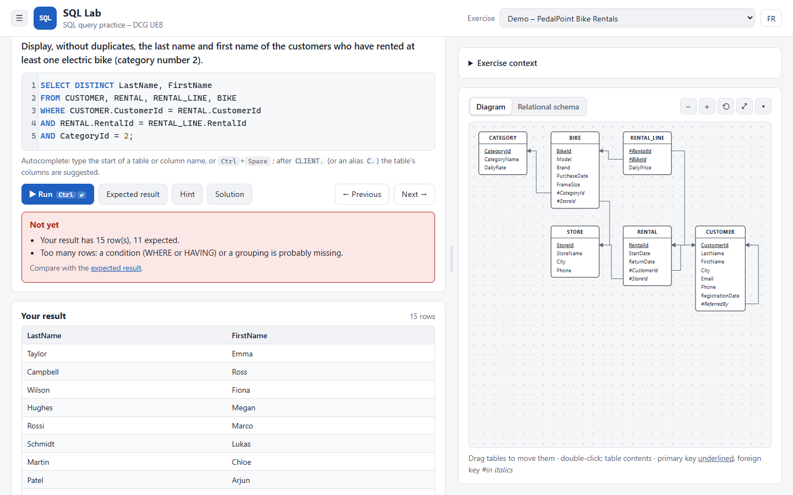
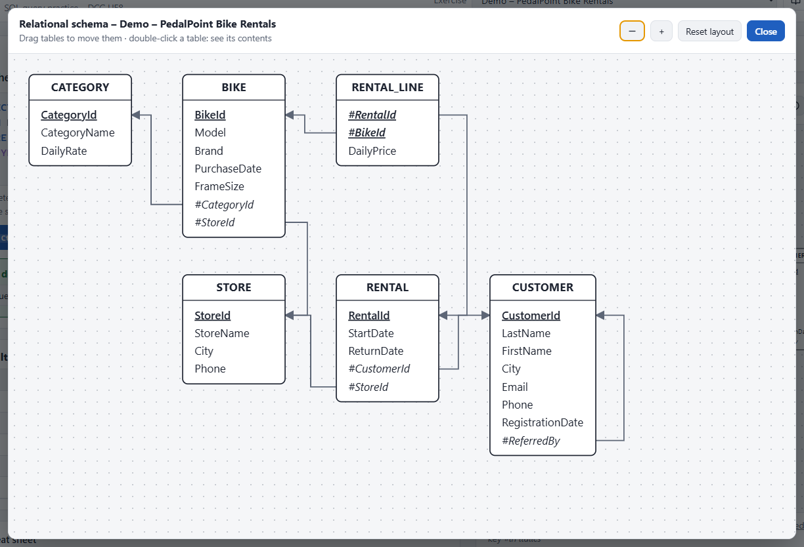
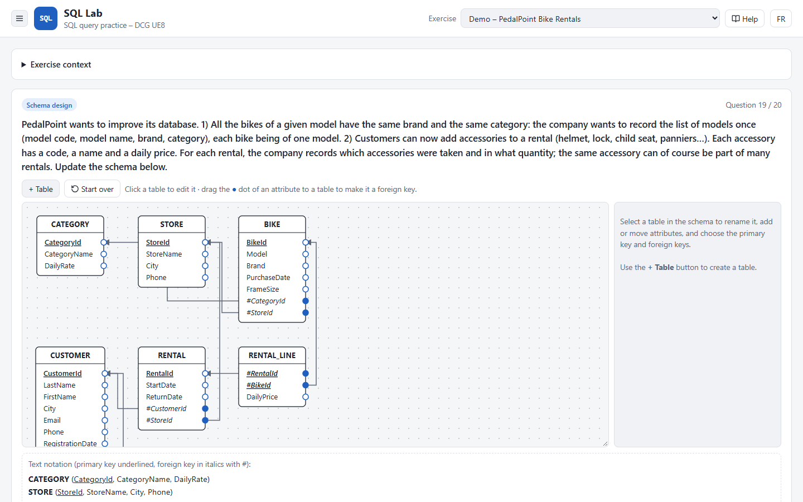
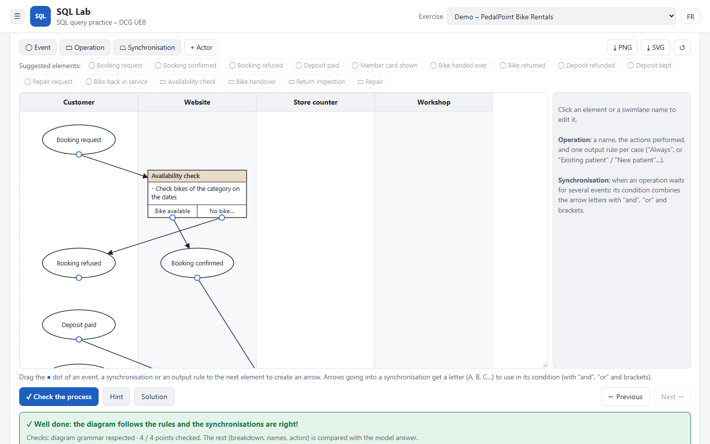
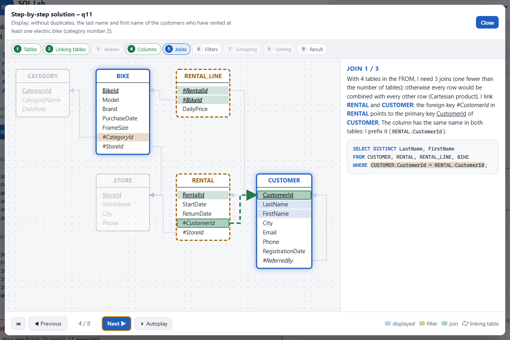
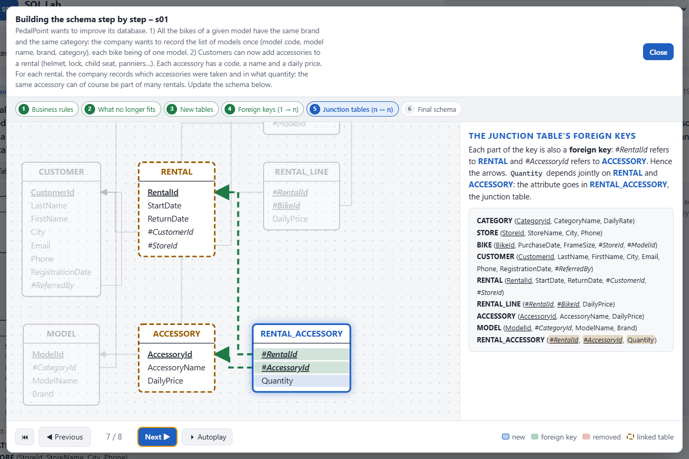
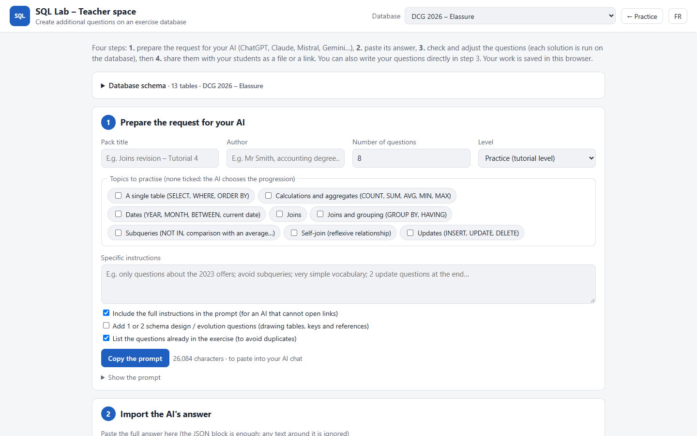

# SQL Lab – SQL practice for business students

*[Version française](README.md)* · **[Open the app (English demo)](https://edu-fpar.github.io/sql-lab/?lang=en#demo-en/intro)** ·
[Teacher space](https://edu-fpar.github.io/sql-lab/create.html?lang=en) · **[Documentation](https://edu-fpar.github.io/sql-lab/docs/#/en/)** (by profile and by topic, [sources](docs/en/))

A static web app (HTML + JavaScript): students write their queries, which run **in the browser**
with SQLite ([sql.js](https://sql.js.org)). No PHP/MySQL server is needed, so it can be hosted on
GitHub Pages. It was built for the French accounting diploma DCG (unit UE8, management
information systems): 18 exercises taken from the 2008–2026 exam papers (in French), about
450 SQL questions, schema-design and process questions, and an animated step-by-step solution.
The interface is available in English, with an **English demo exercise** (`demo-en`).


## What the app does

- Question 0 "Introduction": context, tables, how to work, and a free exploration editor
  (queries run without comparison). The question list can be collapsed (☰ button, collapsed by
  default on phones).
- Questions grouped by topic: single table, aggregates, dates, joins, grouping, subqueries,
  self-join, updates.
- Automatic comparison with the expected result, with targeted hints: duplicates (DISTINCT),
  missing join (Cartesian product), wrong sort order, `= NULL` instead of `IS NULL`, condition on
  an aggregate in WHERE, decimal comma, etc.
- Tolerances: column aliases and column order are free, extra columns are accepted, case is
  ignored, numbers are rounded to 2 decimals.
- **Write queries** (INSERT, UPDATE, DELETE) are simulated: each run starts from a fresh copy of
  the database. The app shows the rows added, changed or deleted and compares them with the
  expected effect.
- **Exam-style dates**: `YEAR()`, `MONTH()`, `DAY()`, `DATEDIFF()`, `NOW()`/`CURDATE()`
  (simulated "today", set per exercise), literals `'2025-03-15'`, `'15/06/2024'` and
  `#15/06/2024#`, `EXTRACT(YEAR FROM …)`.

  
- SQLite error messages are turned into plain-language advice.

  
- Both join styles are accepted: in the `WHERE` clause or with `INNER JOIN … ON`.
- Hint, solution (and alternative writings), expected result, table preview.
- The schema is always visible while writing, in two tabs: **Diagram** (default) and
  **Relational schema** (text). On wide screens the schema column can be resized with the handle
  next to the editor, or collapsed. The tab, width and collapsed state are remembered.
- The diagram follows the French relational notation (not UML): one box per table, primary key
  underlined, foreign key in italics with #, a simple arrow from the foreign key to the primary
  key. Tables can be dragged with the mouse or a finger (layout remembered, ⟲ button), zoom −/+,
  ⤢ to open it full size, double-click to see a table's content.

  
- CodeMirror 5 editor: syntax highlighting and completion of table and column names (from 2
  letters or with Ctrl+Space; after `TABLE.` or `alias.`, only that table's columns are offered).
- Progress and drafts are kept in the student's browser (localStorage).
- Direct link to a question: `index.html#demo-en/q08`.
- Interface language: FR/EN button in the top bar, or `?lang=en` in the address. Only the
  interface is translated: each exercise keeps its own language.

## Schema-design questions

No SQL here: the student evolves a starting schema in a graphical editor (add, rename and delete
tables and attributes, move an attribute to another table, primary key, foreign keys drawn by
dragging an attribute's ● handle onto a table). A properties panel makes everything possible with
the keyboard or on a phone, and the text notation updates live. The check compares the
**structure** with the solution and gives a targeted diagnosis (missing table, attribute to
remove, composite key expected, arrow to the wrong table…), with a score in checkpoints.
Names are compared ignoring case, accents and `_`; a table with an unexpected name is recognised
by its primary key.



## Process questions (event-driven process diagrams)

Practice of the exam formalism: swimlanes (actors) as columns, **events** (ellipses),
**operations** (boxes: name, actions, output rules), **synchronisations** (trapezoids with a
condition such as "A and (B or C)"). Arrows are drawn from the ● handles; arrows entering a
synchronisation get a letter automatically. Export as PNG or SVG.

Automatic check, without a single model answer:
- **grammar of the formalism**: an operation waiting for several events goes through a
  synchronisation; no direct arrow between operations; each output rule produces an event; the
  condition uses all the incoming letters and only them;
- **expected synchronisations**: the triggering logic is compared with the model answer on every
  combination of events ("(C or B) and A" = "A and (B or C)");
- the rest (naming, actors, layout): model answer shown read-only + a self-assessment checklist.



## Step-by-step solution ("cinema mode")

In the solution of an SQL question, the **🎬 Step-by-step solution** button replays the reasoning in the
order we actually think (which is not the order we write): obvious tables → linking tables →
aliases → columns to display → joins → filters → grouping → sorting → result. A strip shows where
we are (steps not needed for this query are struck out), the diagram is animated (tables lit up,
linking tables dashed, columns highlighted by role, the current join's arrow moving) and the
query is built piece by piece. Update queries have their own sequence: table, values, targeted
rows, result.



Schema questions have the same mode (**🎬 Step-by-step build**): business rules → what no longer
fits (struck-out column) → new tables → foreign keys (one-to-many) → junction tables
(many-to-many: composite key, then arrows) → final schema. The diagram evolves at each step.



Nothing to write: the steps are **generated from the solution query** (or from the schema
solution) by `assets/cinema.js`. To replace an automatic comment, add an optional field to the
question: `"cinema": { "passages": "…", "filtres.2": "…" }` (key = step, or `step.n` for the n-th
step of a phase; plain text).

## Teacher space: your own questions, your own database

**`create.html`**:



1. *Prepare the request for your AI*: title, number of questions, topics, level, instructions →
   **Copy the prompt**. The prompt contains the link to the skill
   [`skill/sql-lab-questions/SKILL.md`](skill/sql-lab-questions/SKILL.md) (JSON format and writing
   rules, in French), its content, and an automatic description of the database: tables, columns,
   keys, value ranges, value lists, examples. Any AI works (ChatGPT, Claude, Mistral, Gemini…).
2. *Import the answer*: paste the AI's reply (the JSON block is extracted), open a file, or start
   from an empty pack.
3. *Check and edit*: each solution query is run on the database; errors and things to review are
   flagged (unknown column, empty result, ORDER BY without a checked order, alternative giving a
   different result, update with no effect…). Schema questions are drawn with the same editor as
   the students.
4. *Share*:
   - a **JSON file** for Moodle or e-mail; students use "Import a file";
   - a **link without a server**: `index.html#pack=…`, the questions are compressed into the link
     (after the `#`, so never sent to the server);
   - a **link to a hosted file**: `index.html?pack=https://…/questions.json` (the site must allow
     CORS);
   - a **complete exercise (.zip)**: `exercice.json` + `db.sqlite` or `db.sql`, for your own
     database (`index.html?exercice=https://…/exercice.zip`);
   - a **SCORM 1.2 package**.

Imported questions are added at the end of the list (★ group), kept in the browser and can be
removed. Imported solutions only run in the in-memory database, and all texts are displayed as
text: a malicious file cannot damage anything.

## SCORM 1.2 package (Moodle, Chamilo…)

One package per exercise: the complete app **without any CDN** (libraries in `lib/`), locked on
the exercise.

- **Score** reported: % of questions solved (`cmi.core.score.raw`).
- **Status**: `incomplete`, then `completed` when everything is solved; with a threshold,
  `passed` as soon as the score reaches it (also declared as `masteryscore`).
- **Resume**: solved questions and current question stored by the platform
  (`cmi.suspend_data`, `cmi.core.lesson_location`).
- **Detail**: one interaction per solved question (id + the student's query).

```
npm install
node tools/build_scorm.js demo-en                # → dist/sqllab-demo-en-scorm12.zip
node tools/build_scorm.js dcg2024 my-pack.json --seuil 80
node tools/build_scorm.js --tous                 # one package per exercise in the catalogue
```

or, without installing anything, the **"SCORM package"** button in step 4 of `create.html`.
`tools/scorm-test.html` simulates an SCORM 1.2 platform for testing.

## Structure

```
index.html                  student app
create.html                 teacher space (AI prompt, checks, sharing)
skill/sql-lab-questions/    question format guide, for AIs (French)
exemples/                   sample question pack and custom exercise
lib/                        bundled libraries (sql.js, CodeMirror, fflate): no CDN
assets/
  i18n.js                   interface translation (French keys, English dictionaries per module)
  compat.js                 query rewriting (dates…) and functions added to SQLite
  compare.js                student result / expected result comparison
  engine.js                 execution (fresh copy of the database for each query)
  cinema.js                 step-by-step solutions (SQL and schema)
  diagram.js                graphical relational schema
  schemacheck.js, schema-editor.js     schema questions
  processcheck.js, process-editor.js   process questions
  packs.js, library.js      question packs, imported exercises (zip, IndexedDB)
  scorm.js, scormbuild.js   SCORM 1.2 runtime and package builder
  create.js, create.css     teacher space
  app.js, style.css         interface
exercices/
  catalogue.json            exercises offered in the menu ("langue": "en" for English ones)
  demo-en/                  English demo exercise
  dcg2008 … dcg2026/        French exam-based exercises (questions.json, db.sql, db.sqlite)
tools/
  test_exercice.js          checks solutions, alternatives and diagnostics
  captures.js               regenerates the README screenshots (headless Edge/Chrome)
```

## Adding an exercise

1. Create `exercices/<id>/db.sql` and `db.sqlite`.
2. Write `exercices/<id>/questions.json` (see `exercices/demo-en/questions.json`).
3. Add the exercise to `exercices/catalogue.json` (with `"langue": "en"` if it is in English).
4. Check: `npm install` (once), then `node tools/test_exercice.js <id>`.

## Run locally

The page must be served by a web server (opening the file directly does not work):

```
python -m http.server 8765
```

then open http://localhost:8765/?lang=en.

Screenshots: `node tools/captures.js en` regenerates `docs/img/en/` with headless Edge or Chrome.

## License and citation

© 2026 François Parlant — [CC BY-NC-SA 4.0](https://creativecommons.org/licenses/by-nc-sa/4.0/). Using it in class or in training is free, with credit to the author; adaptations must be shared under the same license. See [LICENSE](LICENSE).

**Commercial use** (publisher, training company, integration into a software product, white label, custom exercises): a commercial license is available by agreement. [Get in touch](https://edu-fpar.github.io/about.html?lang=en).

**How to cite** (GitHub's *Cite this repository* button, from [CITATION.cff](CITATION.cff)):

> Parlant, F. (2026). *SQL Lab* [Educational software]. https://github.com/edu-fpar/sql-lab
