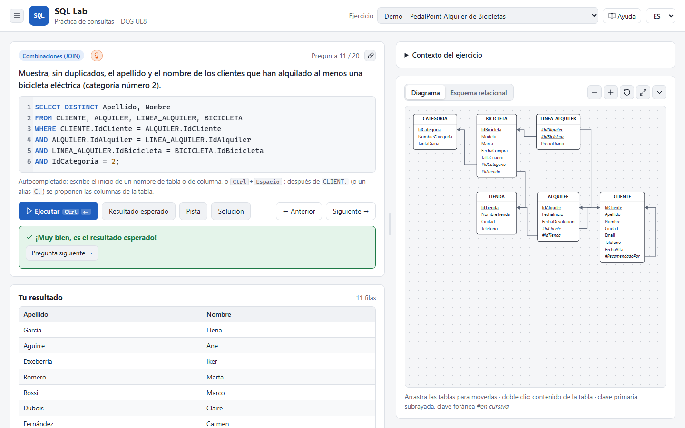
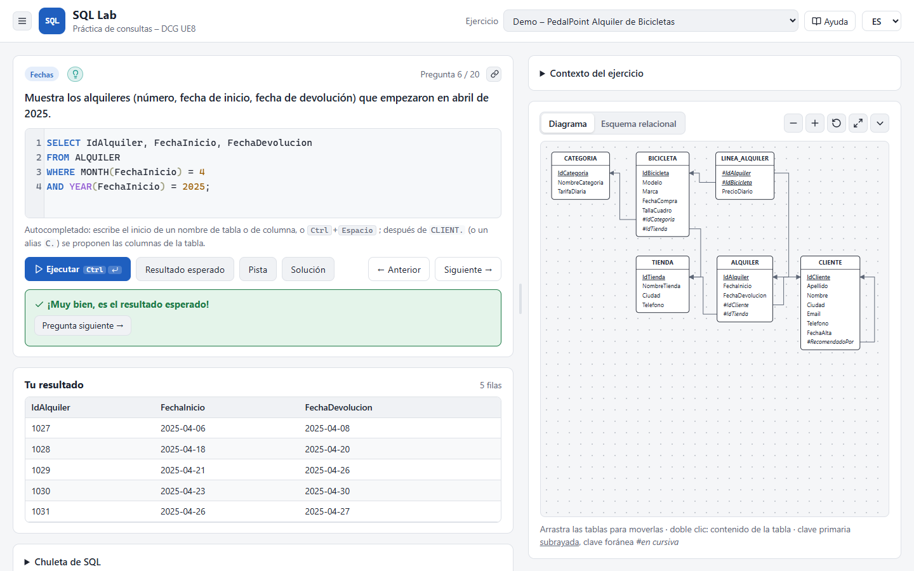
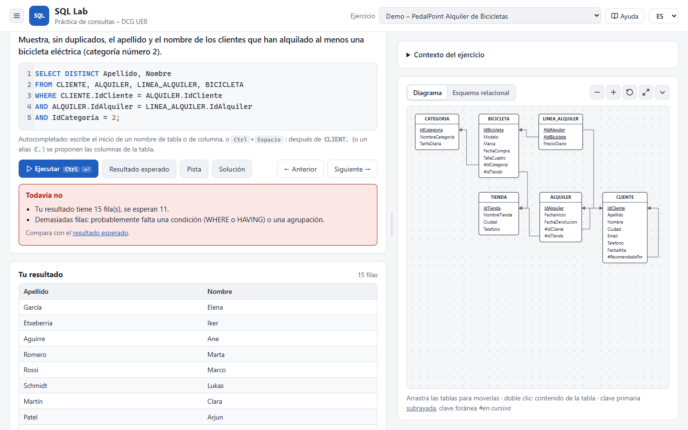
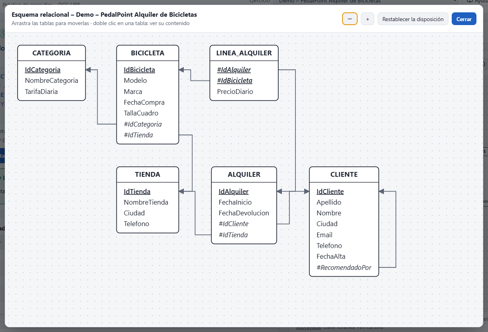
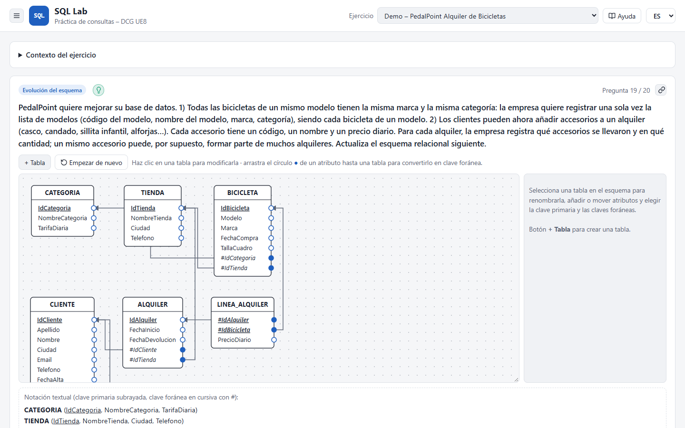
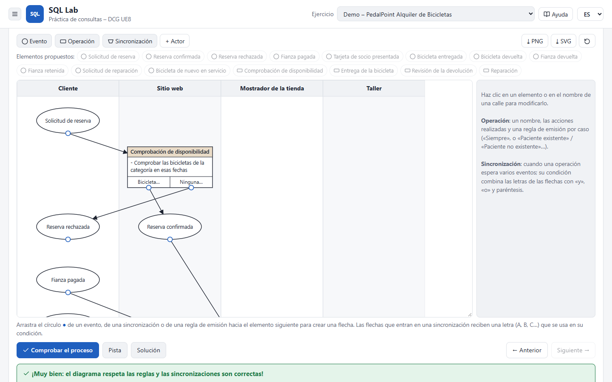
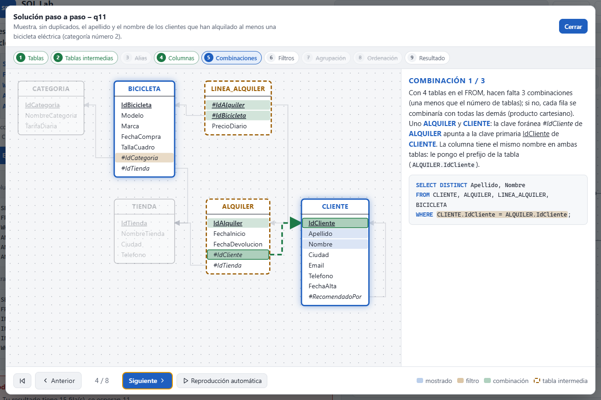
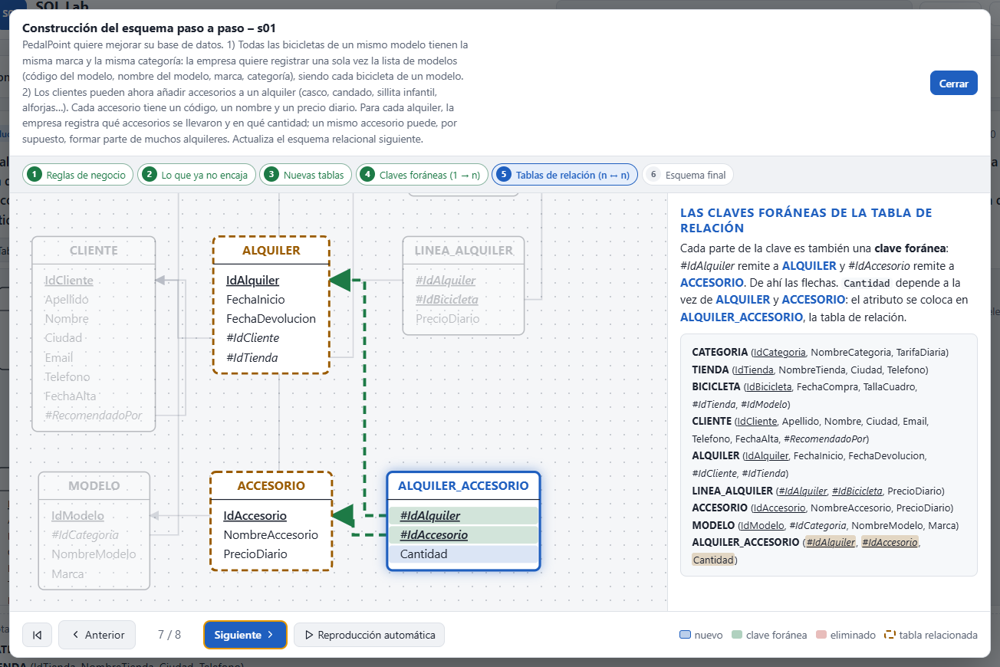
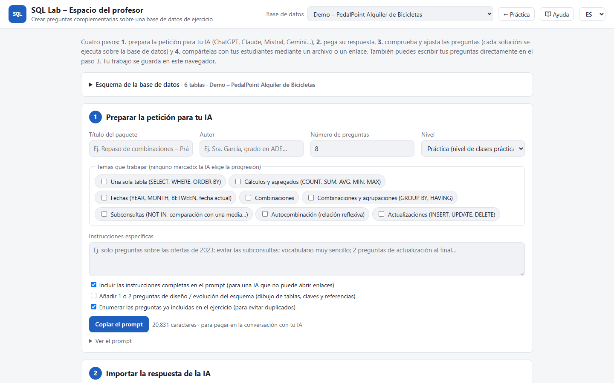

# SQL Lab – práctica de SQL para estudiantes de gestión

**▶ [Abrir la aplicación (demo en español)](https://edu-fpar.github.io/sql-lab/?lang=es#demo-es/intro)**

*[Version française](README.md)* · *[English version](README.en.md)* ·
[Espacio del profesor](https://edu-fpar.github.io/sql-lab/create.html?lang=es) · **[Documentación](https://edu-fpar.github.io/sql-lab/docs/#/es/)** (por perfil y por tema, [fuentes](docs/es/))

[](https://doi.org/10.5281/zenodo.24464411)
Código fuente: [github.com/edu-fpar/sql-lab](https://github.com/edu-fpar/sql-lab)



Aplicación web estática (HTML + JavaScript): los estudiantes escriben sus consultas, que se ejecutan
**en el navegador** con SQLite ([sql.js](https://sql.js.org)). No hace falta ningún servidor PHP/MySQL, así
que se puede alojar en GitHub Pages. Se creó para el diploma francés de contabilidad DCG (unidad UE8,
sistemas de información de gestión): 18 ejercicios sacados de los exámenes de 2008 a 2026 (en francés),
unas 450 preguntas SQL, preguntas de construcción de esquemas y de procesos, y una solución animada paso
a paso. La interfaz está disponible en español y en inglés, con **ejercicios de demostración** en español
(`demo-es`, alquiler de bicicletas) y en inglés (`demo-en`).

## Qué hace la aplicación

- Pregunta 0 «Presentación»: contexto, tablas, método de trabajo y un editor de exploración libre
  (consultas ejecutadas sin comparación). La lista de preguntas se puede plegar (botón ☰, plegada por
  defecto en el móvil).
- Preguntas agrupadas por tema: una tabla, agregados, fechas, combinaciones (JOIN), agrupaciones,
  subconsultas, autocombinación, actualizaciones.
- Comparación automática con el resultado esperado, con indicaciones precisas: duplicados (DISTINCT),
  combinación olvidada (producto cartesiano), orden incorrecto, `= NULL` en lugar de `IS NULL`,
  condición sobre un agregado en WHERE, coma decimal, etc.
- Tolerancias: alias y orden de las columnas libres, columnas de más aceptadas, mayúsculas ignoradas,
  números redondeados a 2 decimales.
- Las **consultas de escritura** (INSERT, UPDATE, DELETE) son simuladas: cada ejecución parte de una copia
  nueva de la base. La aplicación muestra las filas añadidas, modificadas o borradas y las compara con el
  efecto esperado.
- **Fechas como en el examen**: `YEAR()`, `MONTH()`, `DAY()`, `DATEDIFF()`, `NOW()`/`CURDATE()`
  («hoy» simulado, fijado por ejercicio), literales `'2025-03-15'`, `'15/06/2024'` y `#15/06/2024#`,
  `EXTRACT(YEAR FROM …)`.

  
- Los mensajes de error de SQLite se convierten en consejos comprensibles.

  
- Se aceptan las dos formas de combinar tablas: en la cláusula `WHERE` o con `INNER JOIN … ON`.
- Pista, solución (y otras formas de escribirla), resultado esperado, vista previa de las tablas.
- El esquema está siempre visible mientras se escribe, en dos pestañas: **Diagrama** (por defecto) y
  **Esquema relacional** (texto). En pantallas anchas, la columna del esquema se puede redimensionar con
  el asa junto al editor, o plegar. La pestaña, el ancho y el plegado se recuerdan.
- El diagrama sigue la notación relacional francesa (no UML): un recuadro por tabla, clave primaria
  subrayada, clave foránea en cursiva con #, una flecha simple de la clave foránea a la clave primaria.
  Las tablas se arrastran con el ratón o con el dedo (disposición recordada, botón ⟲), zoom −/+, ⤢ para
  abrirlo a pantalla completa, doble clic para ver el contenido de una tabla.

  
- Editor CodeMirror 5: resaltado de sintaxis y autocompletado de nombres de tablas y columnas (a partir de
  2 letras o con Ctrl+Espacio; después de `TABLA.` o `alias.`, solo se proponen las columnas de esa tabla).
- El progreso y los borradores se guardan en el navegador del estudiante (localStorage).
- Enlace directo a una pregunta: `index.html#demo-es/q08`.
- Idioma de la interfaz: selector FR / EN / ES en la barra superior, o `?lang=es` / `?lang=en` en la
  dirección. Solo se traduce la interfaz: cada ejercicio conserva su propio idioma.

## Preguntas de construcción de esquemas

Aquí no hay SQL: el estudiante hace evolucionar un esquema de partida en un editor gráfico (añadir,
renombrar y borrar tablas y atributos, mover un atributo a otra tabla, clave primaria, claves foráneas
dibujadas arrastrando el asa ● de un atributo hasta una tabla). Un panel de propiedades permite hacerlo
todo con el teclado o en el móvil, y la notación textual se actualiza en directo. La comprobación compara
la **estructura** con la solución y da un diagnóstico preciso (tabla que falta, atributo que sobra, clave
compuesta esperada, flecha hacia la tabla equivocada…), con una puntuación por puntos de control. Los
nombres se comparan sin tener en cuenta mayúsculas, acentos ni `_`; una tabla con un nombre inesperado se
reconoce por su clave primaria.



## Preguntas de procesos (diagramas de procesos por eventos)

Práctica del formalismo del examen: carriles (actores) en columnas, **eventos** (elipses), **operaciones**
(recuadros: nombre, acciones, reglas de salida), **sincronizaciones** (trapecios con una condición como
«A y (B o C)»). Las flechas se dibujan desde las asas ●; las flechas que entran en una sincronización
reciben una letra automáticamente. Exportación en PNG o SVG.

Comprobación automática, sin exigir una única respuesta modelo:
- **gramática del formalismo**: una operación que espera varios eventos pasa por una sincronización;
  ninguna flecha directa entre operaciones; cada regla de salida produce un evento; la condición usa
  todas las letras entrantes y solo ellas;
- **sincronizaciones esperadas**: la lógica de activación se compara con la respuesta modelo en todas las
  combinaciones de eventos («(C o B) y A» = «A y (B o C)»);
- el resto (nombres, actores, disposición): respuesta modelo en solo lectura + una lista de
  autoevaluación.



## Solución paso a paso («modo cine»)

En la solución de una pregunta SQL, el botón **🎬 Solución paso a paso** reproduce el razonamiento en el
orden en que realmente pensamos (que no es el orden en que escribimos): tablas evidentes → tablas de
enlace → alias → columnas que mostrar → combinaciones → filtros → agrupación → orden → resultado. Una
banda indica en qué punto estamos (los pasos innecesarios para esta consulta aparecen tachados), el
diagrama se anima (tablas iluminadas, tablas de enlace en discontinuo, columnas resaltadas según su
papel, la flecha de la combinación en curso en movimiento) y la consulta se construye pieza a pieza. Las
consultas de actualización tienen su propia secuencia: tabla, valores, filas afectadas, resultado.



Las preguntas de esquema tienen el mismo modo (**🎬 Construcción paso a paso**): reglas de gestión → lo que
ya no encaja (columna tachada) → tablas nuevas → claves foráneas (uno a varios) → tablas de unión (varios
a varios: clave compuesta y luego flechas) → esquema final. El diagrama evoluciona en cada paso.



No hay nada que escribir: los pasos se **generan a partir de la consulta solución** (o de la solución
del esquema) con `assets/cinema.js`. Para sustituir un comentario automático, añade un campo opcional a
la pregunta: `"cinema": { "passages": "…", "filtres.2": "…" }` (clave = paso, o `paso.n` para el n-ésimo
paso de una fase; texto simple).

## Espacio del profesor: tus propias preguntas, tu propia base de datos

**`create.html`**:



1. *Preparar la petición para tu IA*: título, número de preguntas, temas, nivel, instrucciones →
   **Copiar el prompt**. El prompt contiene el enlace a la skill
   [`skill/sql-lab-questions/SKILL.md`](skill/sql-lab-questions/SKILL.md) (formato JSON y reglas de
   redacción, en francés), su contenido y una descripción automática de la base de datos: tablas,
   columnas, claves, rangos de valores, listas de valores, ejemplos. Sirve cualquier IA (ChatGPT, Claude,
   Mistral, Gemini…).
2. *Importar la respuesta de la IA*: pega la respuesta (se extrae el bloque JSON), abre un archivo o
   empieza con un paquete vacío.
3. *Comprobar y revisar*: cada consulta solución se ejecuta en la base de datos; se señalan los errores y
   lo que hay que revisar (columna desconocida, resultado vacío, ORDER BY sin orden comprobado,
   alternativa que da otro resultado, actualización sin efecto…). Las preguntas de esquema se dibujan con
   el mismo editor que usan los estudiantes.
4. *Compartir con los estudiantes*:
   - un **archivo JSON** para Moodle o el correo; los estudiantes usan «Importar un archivo»;
   - un **enlace sin servidor**: `index.html#pack=…`, las preguntas van comprimidas en el enlace (después
     del `#`, así que nunca se envían al servidor);
   - un **enlace a un archivo alojado**: `index.html?pack=https://…/questions.json` (el sitio debe
     permitir CORS);
   - un **ejercicio completo (.zip)**: `exercice.json` + `db.sqlite` o `db.sql`, para tu propia base de
     datos (`index.html?exercice=https://…/exercice.zip`);
   - un **paquete SCORM 1.2**.

Las preguntas importadas se añaden al final de la lista (grupo ★), se guardan en el navegador y se pueden
quitar. Las soluciones importadas solo se ejecutan en la base de datos en memoria, y todos los textos se
muestran como texto: un archivo malicioso no puede dañar nada.

## Paquete SCORM 1.2 (Moodle, Chamilo…)

Un paquete por ejercicio: la aplicación completa **sin ningún CDN** (bibliotecas en `lib/`), bloqueada en
el ejercicio.

- **Puntuación** enviada: % de preguntas resueltas (`cmi.core.score.raw`).
- **Estado**: `incomplete` y luego `completed` cuando todo está resuelto; con un umbral, `passed` en
  cuanto la puntuación lo alcanza (también declarado como `masteryscore`).
- **Reanudación**: preguntas resueltas y pregunta actual guardadas por la plataforma
  (`cmi.suspend_data`, `cmi.core.lesson_location`).
- **Detalle**: una interacción por pregunta resuelta (id + la consulta del estudiante).

```
npm install
node tools/build_scorm.js demo-es                # → dist/sqllab-demo-es-scorm12.zip
node tools/build_scorm.js dcg2024 mi-paquete.json --seuil 80
node tools/build_scorm.js --tous                 # un paquete por ejercicio del catálogo
```

o, sin instalar nada, el botón **«Paquete SCORM (Moodle…)»** del paso 4 de `create.html`.
`tools/scorm-test.html` simula una plataforma SCORM 1.2 para hacer pruebas.

## Estructura

```
index.html                  aplicación del estudiante
create.html                 espacio del profesor (prompt para la IA, comprobaciones, compartir)
skill/sql-lab-questions/    guía del formato de las preguntas, para las IA (en francés)
exemples/                   paquete de preguntas y ejercicio personalizado de ejemplo
lib/                        bibliotecas incluidas (sql.js, CodeMirror, fflate): sin CDN
assets/
  i18n.js, lang-es.js       traducción de la interfaz (claves en francés; diccionarios ingleses por módulo, español en lang-es.js)
  compat.js                 reescritura de consultas (fechas…) y funciones añadidas a SQLite
  compare.js                comparación resultado del estudiante / resultado esperado
  engine.js                 ejecución (copia nueva de la base para cada consulta)
  cinema.js                 soluciones paso a paso (SQL y esquema)
  diagram.js                esquema relacional gráfico
  schemacheck.js, schema-editor.js     preguntas de esquema
  processcheck.js, process-editor.js   preguntas de procesos
  packs.js, library.js      paquetes de preguntas, ejercicios importados (zip, IndexedDB)
  scorm.js, scormbuild.js   ejecución SCORM 1.2 y generador de paquetes
  create.js, create.css     espacio del profesor
  app.js, style.css         interfaz
exercices/
  catalogue.json            ejercicios del menú ("langue": "es" para los que están en español)
  demo-es/, demo-en/        ejercicios de demostración en español y en inglés
  dcg2008 … dcg2026/        ejercicios franceses basados en exámenes (questions.json, db.sql, db.sqlite)
tools/
  test_exercice.js          comprueba soluciones, alternativas y diagnósticos
  captures.js               regenera las capturas de pantalla (Edge/Chrome sin ventana)
```

## Añadir un ejercicio

1. Crea `exercices/<id>/db.sql` y `db.sqlite`.
2. Escribe `exercices/<id>/questions.json` (ver `exercices/demo-es/questions.json`).
3. Añade el ejercicio a `exercices/catalogue.json` (con `"langue": "es"` si está en español).
4. Comprueba: `npm install` (una vez) y luego `node tools/test_exercice.js <id>`.

## Ejecutar en local

La página debe servirla un servidor web (abrir el archivo directamente no funciona):

```
python -m http.server 8765
```

y luego abre http://localhost:8765/?lang=es.

Capturas: `node tools/captures.js es` regenera `docs/img/es/` con Edge o Chrome sin ventana.

## Licencia y cita

© 2026 François Parlant — [CC BY-NC-SA 4.0](https://creativecommons.org/licenses/by-nc-sa/4.0/deed.es). El uso en clase y en formación es libre, citando al autor; las adaptaciones se comparten con la misma licencia. Ver [LICENSE](LICENSE).

**Uso comercial** (editorial, empresa de formación, integración en un producto de software, marca blanca, ejercicios a medida): es posible una licencia comercial previo acuerdo. [Contactar](https://edu-fpar.github.io/about.html).

**Citar** (botón *Cite this repository* de GitHub, a partir de [CITATION.cff](CITATION.cff)):

> Parlant, F. (2026). *SQL Lab* [Software educativo]. Zenodo. https://doi.org/10.5281/zenodo.24464411
