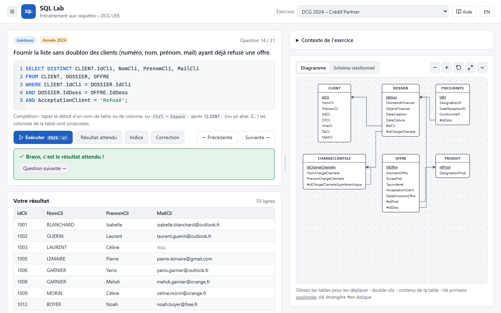
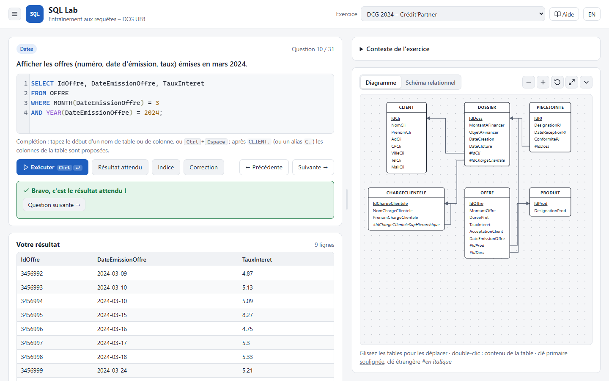
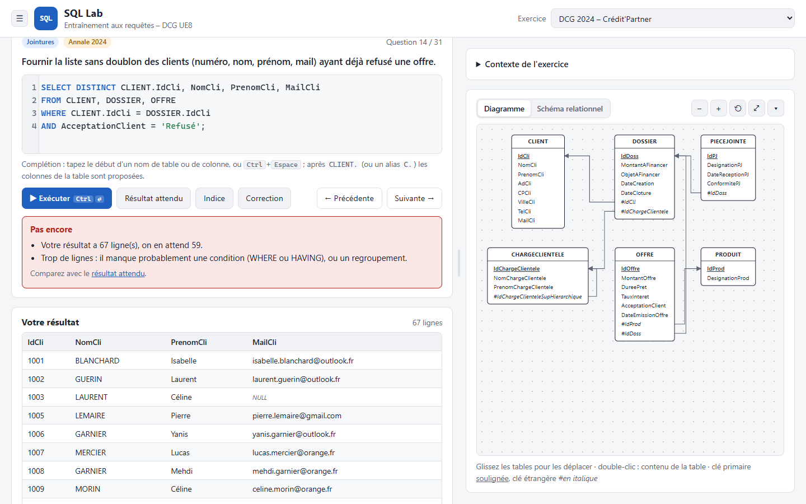
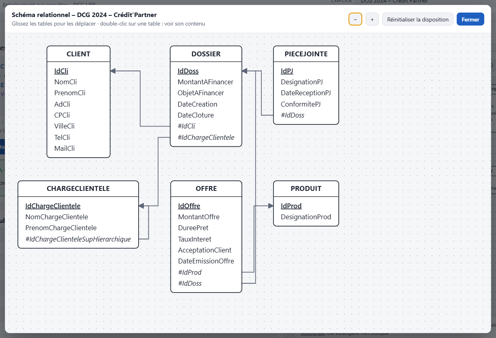
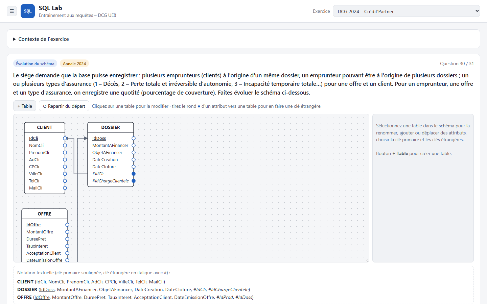
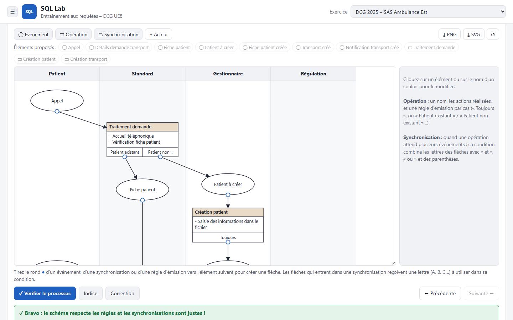
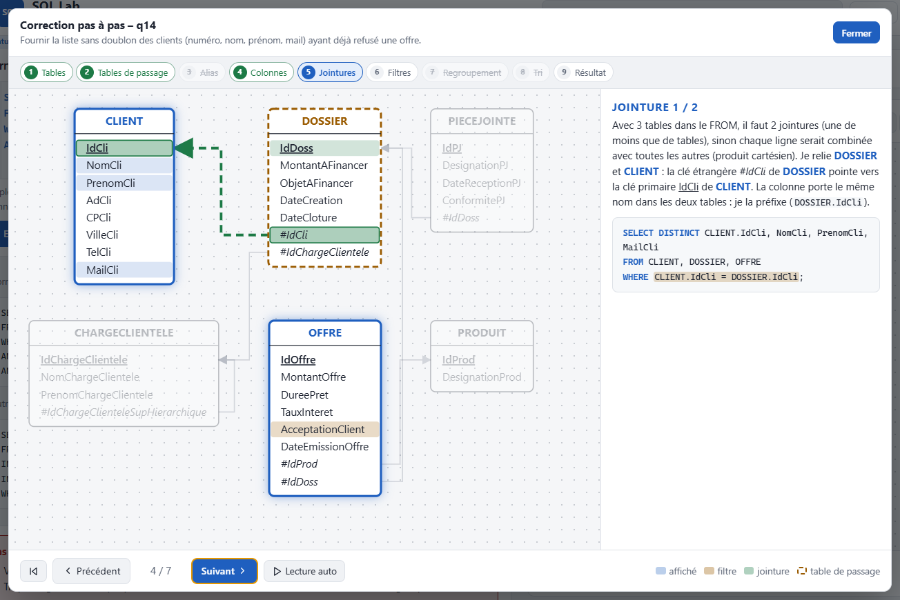
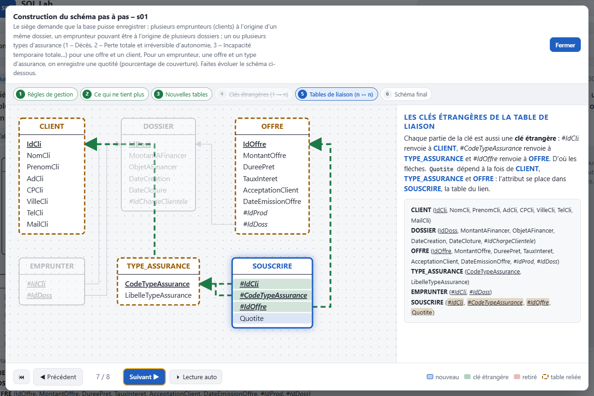
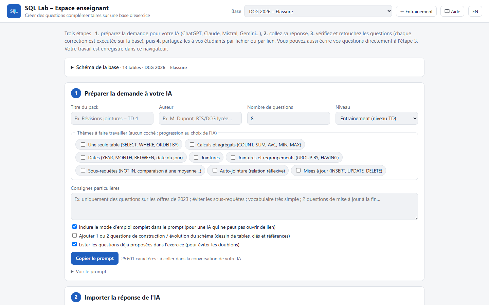

# SQL Lab – entraînement SQL pour l'UE8 du DCG

[](https://doi.org/10.5281/zenodo.24464411)

*[English version](README.en.md)* · *[Documentación en español](https://edu-fpar.github.io/sql-lab/docs/#/es/)* · **[Ouvrir l'application](https://edu-fpar.github.io/sql-lab/)** ·
[Espace enseignant](https://edu-fpar.github.io/sql-lab/create.html) · **[Documentation](https://edu-fpar.github.io/sql-lab/docs/)** (par profil et par thème, [sources](docs/))

Application web statique (HTML + JavaScript) : les étudiants écrivent leurs requêtes,
qui sont exécutées **dans le navigateur** par SQLite ([sql.js](https://sql.js.org)).
Aucun serveur PHP/MySQL n'est nécessaire, ce qui permet un hébergement sur GitHub Pages.
18 exercices tirés des annales 2008 à 2026, environ 450 questions SQL, des questions de
construction de schéma et de processus, et une correction pas à pas animée.



## Ce que fait l'application

- Question 0 « Présentation » : contexte, tables, méthode de travail, et éditeur en exploration
  libre (requêtes exécutées sans comparaison). Le menu des questions se replie (bouton ☰,
  replié par défaut sur téléphone).
- Progression de questions par thème : une table, agrégats, dates, jointures, regroupements,
  sous-requêtes, auto-jointure, mises à jour.
- Comparaison automatique avec le résultat attendu, avec des indications ciblées :
  doublons (DISTINCT), oubli de jointure (produit cartésien), mauvais ordre de tri,
  `= NULL` au lieu de `IS NULL`, condition sur un agrégat dans WHERE, virgule décimale, etc.
- Tolérances : alias et ordre des colonnes libres, colonnes en trop acceptées,
  casse ignorée, nombres arrondis à 2 décimales.
- Les **requêtes d'écriture** (INSERT, UPDATE, DELETE) sont fictives : chaque exécution
  repart d'une copie neuve de la base. L'application montre les lignes ajoutées, modifiées
  ou supprimées, et les compare à l'effet attendu.
- **Dates « à la DCG »** : `YEAR()`, `MONTH()`, `DAY()`, `DATEDIFF()`, `NOW()`/`CURDATE()`
  (date du jour simulée, fixée par exercice), littéraux `'15/06/2024'` et `#15/06/2024#`,
  `EXTRACT(YEAR FROM …)`.

  
- Les messages d'erreur de SQLite sont traduits en conseils en français.

  
- Les deux écritures des jointures sont acceptées : dans le `WHERE` ou avec `INNER JOIN … ON`.
- Indice, correction (et variantes d'écriture), résultat attendu, aperçu des tables.
- Schéma toujours visible pendant l'écriture, en deux onglets : **Diagramme** (par défaut) et
  **Schéma relationnel** (liste textuelle). Sur grand écran, la colonne du schéma s'élargit avec
  la poignée qui la sépare de l'éditeur ; elle peut aussi être repliée. Le choix de l'onglet,
  la largeur et le repli sont mémorisés.
- Le diagramme suit la notation française (pas UML) : une boîte par table, clé primaire
  soulignée, clé étrangère en italique avec #, flèche simple de la clé étrangère vers la clé
  primaire. Les tables se déplacent à la souris ou au doigt (disposition mémorisée, bouton ⟲),
  zoom −/+, bouton ⤢ pour l'ouvrir en grand, double-clic pour voir le contenu d'une table.
  Dans une colonne étroite, les tables sont disposées en hauteur.
  La disposition initiale se règle par exercice avec `schemaGrid` dans `questions.json`
  (`{"TABLE": [colonne, ligne]}`) ; sans ce réglage, une grille automatique est utilisée.

  
- Éditeur CodeMirror 5 : coloration syntaxique et complétion des noms de tables et de colonnes
  (dès 2 lettres ou avec Ctrl+Espace ; après `TABLE.` ou `alias.`, seules les colonnes de cette
  table sont proposées).
- La progression et les brouillons sont conservés dans le navigateur de l'étudiant (localStorage).
- Lien direct vers une question : `index.html#dcg2024/q14`.

## Structure

```
index.html                  application étudiant
create.html                 espace enseignant (prompt IA, vérification, partage)
skill/sql-lab-questions/    mode d'emploi du format de questions, pour les IA
exemples/                   pack de questions et exercice personnel d'exemple
lib/                        bibliothèques embarquées (sql.js, CodeMirror, fflate) : aucun CDN
dist/                       paquets SCORM générés (non versionnés)
assets/
  compat.js                 réécriture des requêtes (dates…) et fonctions ajoutées à SQLite
  compare.js                comparaison résultat étudiant / résultat attendu
  engine.js                 exécution (copie neuve de la base à chaque requête)
  packs.js                  packs de questions : contrôle, vérification, lien compressé, description de la base
  diagram.js                schéma relationnel graphique
  library.js                exercices intégrés et importés (zip, IndexedDB)
  scorm.js                  liaison SCORM 1.2 avec la plateforme
  scormbuild.js             construction d'un paquet SCORM
  create.js, create.css     espace enseignant
  app.js, style.css         interface
exercices/
  catalogue.json            liste des exercices proposés dans le menu
  dcg2024/
    questions.json          contexte, date du jour simulée, questions
    db.sql                  base lisible (CREATE TABLE + INSERT)
    db.sqlite               base chargée par l'application
tools/
  gen_dcg2024.py            génère db.sql et db.sqlite (données fictives, graine fixe)
  test_exercice.js          vérifie corrections, variantes et diagnostics
annales/                    sujets et corrigés d'origine (ne pas publier si non souhaité)
```

## Questions « schéma » (construction / évolution du modèle relationnel)

Type de question sans SQL : l'étudiant fait évoluer un schéma de départ dans un éditeur graphique
(ajout, renommage et suppression de tables et d'attributs, déplacement d'un attribut vers une autre
table, clé primaire, clés étrangères tracées en tirant le rond ● d'un attribut vers une table) ;
un panneau de propriétés permet tout au clavier et sur téléphone, et la notation textuelle DCG se
met à jour en direct. La correction compare la **structure** à la solution et donne un diagnostic
ciblé (table manquante, attribut à retirer, clé composée attendue, flèche vers la mauvaise table…),
avec un score en points de contrôle.

```json
{
  "id": "s01", "type": "schema", "theme": "Évolution du schéma",
  "enonce": "…",
  "depart": ["CLIENT", "DOSSIER", "OFFRE"],
  "solution": { "tables": [
    { "nom": "DOSSIER", "interdits": ["IdCli"] },
    { "nom": "EMPRUNTER", "alias": ["EMPRUNT"], "role": "relier les emprunteurs et les dossiers",
      "pk": ["IdCli", "IdDoss"], "fk": { "IdCli": "CLIENT", "IdDoss": "DOSSIER" },
      "attributs": [], "optionnels": [] }
  ], "tablesOptionnelles": [], "tablesSupprimees": [] },
  "variantes": [ { "tables": [ … ] }, { "tables": [ … ], "partiel": "Message si réponse seulement en partie juste" } ],
  "indice": "…"
}
```

- `depart` : `"base"` (toute la base), une liste de tables de la base, ou des tables décrites :
  `{ "nom": "PERSONNEL", "colonnes": ["_NumPersonnel", "NomPersonnel", "#CodeSalon>SALON"] }`
  (`_` = clé primaire, `#…>TABLE` = clé étrangère).
- Noms comparés sans tenir compte de la casse, des accents ni des `_` ; équivalents d'un attribut
  séparés par `|` (`"NumPersonnelHydro|NumPersonnel"`) ; une table au nom imprévu est reconnue
  par sa clé primaire ; `role` sert au message « Il manque une table pour … ».
- Chaque base a au moins une question de schéma tirée de son annale (évolution demandée par le
  sujet, solution et variantes du corrigé, réponses « partiellement exactes »).
- Éviter les alias vagues communs à plusieurs tables (par ex. « TRAVAUX ») : la reconnaissance
  par le nom se ferait sur la mauvaise table ; une table au nom imprévu reste reconnue par sa clé.
- Un schéma identique au départ est toujours signalé « non modifié ».
- **Espace de création** : bouton « + Question de schéma » ; on coche les tables de départ, on
  **dessine la solution** avec le même éditeur que l'étudiant, et la grille de correction en est
  déduite (nouvelles tables, clés, références, attributs à retirer). Zones « Noms acceptés »
  (`EMPRUNTER = EMPRUNT, EMPRUNTEUR`, `SOUSCRIRE.Quotite = Pourcentage`) et « Rôle des nouvelles
  tables ». Les variantes se définissent dans le fichier JSON et sont conservées.
- La skill décrit ce format : l'IA peut proposer des questions de schéma (case à cocher du prompt).
- Tests : `node tools/test_exercice.js` vérifie que chaque solution est reconnue, que le schéma de
  départ seul est refusé, et que des erreurs typiques donnent le bon diagnostic.



## Questions « processus » (schéma événements-résultats)

Espace d'entraînement au formalisme des annales : couloirs (acteurs) en colonnes, **événements**
(bulles), **opérations** (cases : nom, actions, règles d'émission), **synchronisations** (trapèzes
avec une condition « A et (B ou C) »). Les flèches se tirent depuis les ronds ● ; celles qui entrent
dans une synchronisation reçoivent une lettre automatiquement. Panneau de propriétés, éléments
proposés facultatifs, export du schéma en PNG ou SVG. Ces questions se placent en fin de série.

Vérification automatique, sans corrigé unique :
- **grammaire du formalisme** : une opération qui attend plusieurs événements passe par une
  synchronisation ; pas de flèche directe entre opérations ; chaque règle d'émission produit un
  événement ; la condition n'utilise que les lettres des flèches entrantes, et toutes ;
- **synchronisations attendues** : la logique de déclenchement est comparée à celle du corrigé sur
  toutes les combinaisons d'événements (« (C ou B) et A » = « A et (B ou C) ») ; nombre ou cas des
  règles d'émission d'une opération ;
- le reste (découpage, noms, acteurs) : corrigé affiché en lecture seule + liste d'auto-évaluation.

```json
{
  "id": "p01", "type": "processus", "theme": "Processus",
  "enonce": "…",
  "couloirs": ["Patient", "Standard", "Gestionnaire", "Régulation"],
  "elements": [ { "kind": "event", "label": "Appel" }, { "kind": "operation", "label": "Création transport" } ],
  "attendus": [
    { "operation": "Création transport", "alias": ["Créer transport"],
      "synchronisation": "Détails demande transport ET (Fiche patient OU Fiche patient créée)" },
    { "operation": "Traitement demande", "regles": ["Patient existant", "Patient non existant"] }
  ],
  "equivalents": { "Fiche patient créée": ["Patient créé"] },
  "solution": { "lanes": [], "nodes": [], "arrows": [] },
  "autoevaluation": ["…"]
}
```

`depart` (facultatif, même format que `solution`) : schéma partiel donné à compléter, comme les
annexes « à compléter » des sujets. `couloirs` absent : l'étudiant crée ses acteurs.
Dans une condition attendue, un nom d'événement qui contient « et » / « ou » se met entre
guillemets : `"Lundi ou jeudi" ET Dossier reçu`. Un événement que le corrigé tolère sans
l'exiger se déclare dans `"facultatifs": ["Relevés météo"]` (au niveau de l'attendu concerné). `elements` absent : pas d'éléments proposés.
Exemple : `dcg2025` (question `p01`). Pas encore d'édition dans l'espace de création : la solution
se dessine dans l'application puis se recopie depuis le brouillon (ou s'écrit dans le JSON).



## Correction pas à pas (« mode cinéma »)

Dans la correction d'une question SQL, le bouton **Correction pas à pas** rejoue le
raisonnement, dans l'ordre où on le mène (qui n'est pas l'ordre d'écriture) : tables évidentes →
tables de passage → alias → colonnes à afficher → jointures → filtres → regroupement → tri →
résultat. Une frise montre où l'on en est (les phases inutiles pour la requête sont barrées), le
diagramme s'anime (tables allumées, tables de passage en pointillés, colonnes surlignées par rôle,
flèche de la jointure en cours) et la requête se construit morceau par morceau. Les requêtes de
mise à jour ont leur propre déroulé : table, valeurs, lignes visées, résultat.



Les questions de **schéma** ont le même mode (**Construction pas à pas**) : règles de gestion →
ce qui ne tient plus (colonne barrée) → nouvelles tables → clés étrangères (relation un à
plusieurs) → tables de liaison (plusieurs à plusieurs, clé composée puis flèches) → schéma final.
Le diagramme évolue à chaque étape.



Rien à écrire : les étapes sont **générées à partir de la correction** (ou de la solution du
schéma) par `assets/cinema.js`.
**Correction commentée.** Pour quelques questions choisies (une par thème dans chaque exercice,
et toutes les questions de schéma), l'enseignant ajoute ses propres commentaires avec le champ
facultatif `cinema`. La question est alors marquée d'un clap dans la liste, et le bouton devient
« Correction commentée pas à pas ».

```json
"cinema": {
  "+tables": "C'est le mot « responsable » qui indique le chemin : le dossier connaît son chargé.",
  "+jointures.2": "Une jointure **par flèche traversée**, jamais de raccourci.",
  "lecture": "- Règle 1 : un dossier a **plusieurs** emprunteurs → table de liaison\n- Règle 2 : …"
}
```

- `+phase` ou `+phase.n` **ajoute** un encadré « Point de méthode » sous le commentaire automatique
  (première étape de la phase, ou la n-ième) ;
- `phase` ou `phase.n` **remplace** le commentaire automatique ;
- texte brut, avec `**gras**`, `` `code` `` et des lignes `- ` pour une liste.

Phases SQL : `tables`, `passages`, `alias`, `select`, `jointures`, `filtres`, `groupe`, `tri`,
`resultat` (mises à jour : `table`, `valeurs`, `ciblage`). Phases schéma : `lecture`, `retraits`,
`entites`, `liens`, `associations`, `bilan`.

Outils : `node tools/cinema_plan.js <exercice> <question>` affiche les étapes générées et leurs clés ;
`node tools/set_cinema.js <exercice> <question> commentaires.json` écrit le champ sans reformater le
fichier ; `node tools/test_exercice.js` signale toute clé qui ne vise aucune étape.

## Format d'une question (`questions.json`)

```json
{
  "id": "q17",
  "theme": "Jointures et regroupements",
  "enonce": "…",
  "annale": "2024",
  "ordered": [2],
  "correction": ["SELECT …", "FROM …"],
  "variantes": [["SELECT …", "FROM … INNER JOIN …"]],
  "indice": "…"
}
```

- `correction` / `variantes` : une chaîne ou un tableau de lignes.
- `ordered` : à indiquer seulement si l'énoncé demande un tri ; liste des colonnes
  (indices à partir de 0) sur lesquelles porte le tri. Les ex æquo peuvent être dans n'importe quel ordre.
- Pour une requête d'écriture : `"type": "write"` et `"verif": "SELECT * FROM TABLE ORDER BY …"`
  (requête qui photographie la table modifiée, avant et après).
- `allerPlusLoin` (facultatif, aussi pour les questions de schéma) : le cas plus complexe à
  envisager (homonymes, jointure externe, clé minimale…), affiché dans un encadré « Pour aller plus
  loin » sous la correction et à la dernière étape du pas à pas. Texte avec `**gras**`, `` `code` ``
  et des lignes `- `.

## Questions complémentaires (enseignants)

Un enseignant peut ajouter ses propres questions sur une base existante, sans toucher au dépôt.

**Espace enseignant : `create.html`** (lien « Créer des questions » dans le menu)



1. *Préparer la demande à votre IA* : titre, nombre de questions, thèmes, niveau, consignes →
   bouton **Copier le prompt**. Le prompt contient le lien vers la skill
   [`skill/sql-lab-questions/SKILL.md`](skill/sql-lab-questions/SKILL.md) (format JSON et règles
   de rédaction), son contenu (pour les IA qui n'ouvrent pas les liens), et une description
   détaillée de la base générée automatiquement : tables, colonnes, clés, plages de valeurs,
   listes de valeurs, exemples. N'importe quelle IA convient (ChatGPT, Claude, Mistral, Gemini…).
2. *Importer la réponse* : coller la réponse de l'IA (le bloc JSON est extrait du texte), ou
   ouvrir un fichier, ou partir d'un pack vide.
3. *Vérifier et retravailler* : chaque correction est exécutée sur la base ; erreurs et points à
   relire sont signalés (colonne inconnue, résultat vide, ORDER BY sans ordre vérifié, variante
   qui ne donne pas le même résultat, modification sans effet…). Édition, tri, duplication,
   colonnes de tri à cocher sur le résultat. Brouillon enregistré dans le navigateur.
4. *Partager* :
   - **fichier JSON** à déposer sur Moodle ou envoyer ; l'étudiant fait « Importer un fichier » ;
   - **lien sans serveur** : `index.html#pack=…`, les questions sont compressées dans le lien
     (après le `#`, donc jamais envoyées au serveur) ; environ 1 300 caractères pour 5 questions ;
   - **lien vers un fichier hébergé** : `index.html?pack=https://…/questions.json`
     (GitHub, Gist « raw »… : le site doit autoriser CORS). Les étudiants récupèrent la dernière
     version à chaque ouverture du lien.

Côté étudiant, les questions importées s'ajoutent en fin de liste (groupe ★), sont conservées dans
le navigateur et peuvent être retirées. Un pack de même titre et même auteur remplace le précédent.
Les corrections importées ne s'exécutent que dans la base en mémoire du navigateur, et tous les
textes sont affichés comme du texte : un fichier malveillant ne peut rien abîmer.

Format : voir la skill ; exemple dans [`exemples/pack-exemple-dcg2024.json`](exemples/pack-exemple-dcg2024.json).
Vérification en ligne de commande : `node tools/test_pack.js <fichier.json>`.

## Exercice sur sa propre base (zip)

Un enseignant peut apporter **sa propre base** :

- un **zip** contenant `exercice.json` (titre, contexte, date du jour simulée, `schemaGrid`
  facultatif, questions ; format `sql-lab-exercice/1`) et `db.sqlite` **ou** `db.sql`
  (script `CREATE TABLE` + `INSERT`) ;
- ou simplement un fichier `.sqlite`, `.db` ou `.sql` : l'exercice est alors créé sans question.

Modèle : [`exemples/exercice-perso-mediatheque/`](exemples/exercice-perso-mediatheque/)
(zip construit avec `node tools/zip_exercice.js exemples/exercice-perso-mediatheque`).

- **Étudiant** : « Importer un fichier » (le même bouton accepte .json et .zip), ou lien
  `index.html?exercice=https://…/exercice.zip`. L'exercice apparaît dans le menu
  (« Exercices importés ») et reste dans le navigateur (IndexedDB) ; il peut être retiré
  depuis sa page de présentation.
- **Enseignant** (`create.html`) : « ＋ Charger ma base… » dans la liste des bases, puis
  titre, contexte et date du jour simulée ; le prompt IA et la vérification des questions
  fonctionnent sur sa base. Partage par « Exercice complet (.zip) ».
- Contrôles à l'import : fichier SQLite valide, au moins une table, taille (avertissement
  au-delà de 20 Mo, refus au-delà de 100 Mo), dates stockées en jj/mm/aaaa signalées
  (il faut AAAA-MM-JJ), absence de clés étrangères signalée (pas de flèches dans le diagramme).
- Une base ne peut pas tenir dans un lien long : fichier ou zip hébergé uniquement.

## Paquet SCORM 1.2 (Moodle, Chamilo…)

Un paquet par exercice : l'application complète **sans CDN** (bibliothèques dans `lib/`),
verrouillée sur l'exercice (pas de choix d'exercice ni d'import).

- **Score** transmis : % de questions réussies (`cmi.core.score.raw`).
- **Statut** : `incomplete`, puis `completed` quand tout est réussi ; avec un seuil,
  `passed` dès que le score l'atteint (aussi déclaré en `masteryscore` dans le manifeste).
- **Reprise** : questions réussies et question en cours conservées par la plateforme
  (`cmi.suspend_data`, `cmi.core.lesson_location`) ; la plateforme fait foi, même sur un
  poste partagé. Les brouillons de requêtes restent dans le navigateur (limite SCORM 1.2).
- **Détail** : une interaction par question réussie (identifiant + requête de l'étudiant).

Production :

```
npm install
npm run vendor                                   # copie les bibliothèques dans lib/ (déjà fait)
node tools/build_scorm.js dcg2024                # → dist/sqllab-dcg2024-scorm12.zip
node tools/build_scorm.js dcg2024 mon-pack.json --seuil 80
node tools/build_scorm.js exemples/exercice-perso-mediatheque.zip
node tools/build_scorm.js --tous                 # un paquet par exercice du catalogue
```

ou, sans rien installer, bouton **« Paquet SCORM »** à l'étape 4 de `create.html`
(base + questions de l'exercice + questions du pack, seuil facultatif).

Dans Moodle : *Ajouter une activité → Paquetage SCORM*, déposer le zip ; régler l'évaluation
sur « Note la plus élevée » ou « Dernière tentative » selon l'usage.

**Tester sans plateforme** : `tools/scorm-test.html` simule une plateforme SCORM 1.2
(objet `API`, données conservées entre deux sessions, journal des appels). Décompresser le
paquet dans `dist/test/<id>/`, puis ouvrir
`http://localhost:8765/tools/scorm-test.html?paquet=../dist/test/<id>/index.html`.

## Ajouter un exercice

1. Écrire `exercices/<id>/db.sql` (CREATE TABLE avec REFERENCES + INSERT), puis
   `node tools/build_db.js <id>` pour produire `db.sqlite` (`node tools/build_db.js --verifier`
   contrôle que toutes les bases correspondent à leur script). Noms de tables et de colonnes
   simples : lettres sans accent, chiffres, `_`, pas de mot réservé du SQL (`Date`, `Year`…) ;
   les tests le vérifient.
2. Écrire `exercices/<id>/questions.json`.
3. Ajouter l'exercice dans `exercices/catalogue.json`, avec un champ `source` dans
   `questions.json` (« Inspiré du sujet DCG UE8 session 2024, dossier 3. Données entièrement
   fictives. » : cette forme est traduite automatiquement). Pour modifier un champ d'une question
   sans reformater le fichier : `node tools/set_field.js <id> <question> <champ> valeur.json`.
4. Vérifier : `npm install` (une fois), puis `node tools/test_exercice.js <id>`
   (`npm test` pour dcg2024).

## Tester en local

La page doit être servie par un serveur web (pas d'ouverture directe du fichier) :

```
python -m http.server 8765
```

puis ouvrir http://localhost:8765. UwAmp convient aussi.

## Documentation

Le dossier `docs/` est un site [docsify](https://docsify.js.org) (embarqué dans `lib/docsify`, sans CDN) :
guide par profil, par thème et référence, en français, en anglais (`docs/en/`) et en espagnol (`docs/es/`). Il est servi
par GitHub Pages à `/sql-lab/docs/` et accessible depuis le bouton **Aide** de l'application.

## Captures d'écran

`node tools/captures.js fr` (ou `en`, `es`) régénère les captures de `docs/img/` avec Edge ou Chrome
sans fenêtre, à partir du serveur local (profil temporaire, rien n'est écrit dans le navigateur).

## Publier sur GitHub Pages

Pousser le dossier dans un dépôt, puis *Settings → Pages → Deploy from a branch* (racine).
Le `.gitignore` exclut déjà `annales/` (sujets d'origine), `node_modules/` et `.claude/`.

## Licence et citation

© 2026 François Parlant — [CC BY-NC-SA 4.0](https://creativecommons.org/licenses/by-nc-sa/4.0/deed.fr). L'usage en classe et en formation est libre, en citant l'auteur ; vos adaptations se partagent sous la même licence. Voir [LICENSE](LICENSE).

**Usage commercial** (éditeur, organisme de formation, intégration dans un logiciel, marque blanche, exercices sur mesure) : une licence commerciale est possible sur accord. [Me contacter](https://edu-fpar.github.io/about.html).

**Citer cet outil** (bouton *Cite this repository* de GitHub, d'après [CITATION.cff](CITATION.cff)) :

> Parlant, F. (2026). *SQL Lab* [Logiciel pédagogique]. Zenodo. https://doi.org/10.5281/zenodo.24464411
