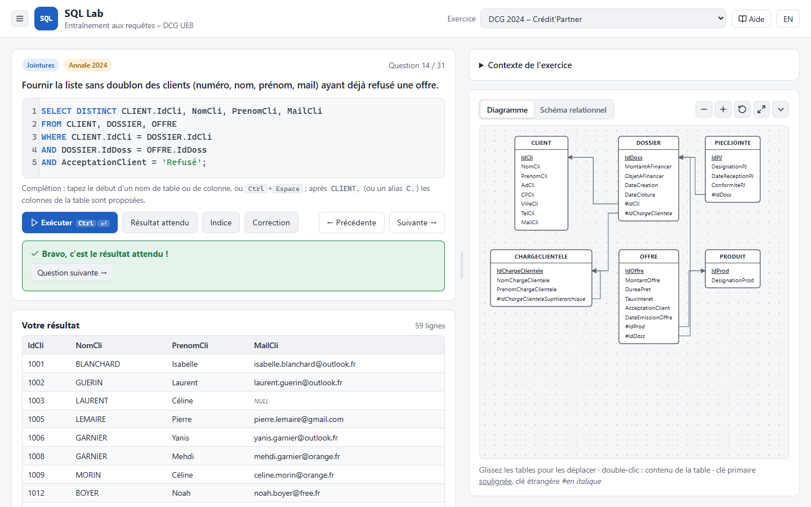

# Documentation de SQL Lab

**[Ouvrir l'application](https://edu-fpar.github.io/sql-lab/)** ·
[Espace enseignant](https://edu-fpar.github.io/sql-lab/create.html) ·
[Code source](https://github.com/edu-fpar/sql-lab)

SQL Lab est une application web d'entraînement au SQL pour les étudiants en gestion (DCG UE8,
BTS, licence). Les requêtes s'exécutent **dans le navigateur** : rien à installer, pas de
compte, aucune donnée envoyée. L'application propose :

- 18 exercices tirés des annales du DCG (2008 à 2026), avec environ 450 questions SQL ;
- des questions de construction de schéma et de processus ;
- une correction pas à pas animée ;
- un espace enseignant pour créer ses questions avec l'IA, utiliser sa propre base et exporter
  en SCORM.

## Visite guidée en vidéo

<iframe class="video-frame" src="../intro.html?embed=doc&lang=fr" title="Visite guidée en vidéo" loading="lazy"></iframe>

Une minute pour découvrir chaque outil, avec voix et sous-titres en français, anglais et espagnol. [Ouvrir la page de la vidéo](../intro.html?lang=fr ':ignore')

## Qui êtes-vous ?

  <a href="#/profils/etudiant"><b><i class="i i-graduation-cap"></i> Étudiant</b>Me tester sur le SQL, comprendre mes erreurs, revoir une correction pas à pas.</a>
  <a href="#/profils/enseignant"><b><i class="i i-presentation"></i> Enseignant, formateur</b>Utiliser en cours, ajouter des questions, ma propre base, noter dans Moodle.</a>
  <a href="#/profils/etablissement"><b><i class="i i-school"></i> Établissement</b>Déployer dans le LMS, héberger en interne, conformité RGPD.</a>
  <a href="#/profils/chercheur"><b><i class="i i-microscope"></i> Universitaire, chercheur</b>Citer ce logiciel, l'utiliser dans une expérimentation, l'adapter.</a>
  <a href="#/profils/edtech"><b><i class="i i-building-2"></i> EdTech, éditeur</b>L'intégrer dans mon logiciel, licence commerciale, exercices sur mesure.</a>
  <a href="#/profils/developpeur"><b><i class="i i-code-xml"></i> Développeur</b>Lancer en local, ajouter un exercice, traduire, signaler un problème.</a>

## Par thème

| Thème | En bref |
|---|---|
| [Requêtes et correction automatique](themes/requetes) | tolérances, diagnostics, mises à jour fictives, dates « à la DCG » |
| [Schéma relationnel](themes/schema) | diagramme en notation française, questions de construction de schéma |
| [Processus](themes/processus) | schémas événements-résultats, synchronisations vérifiées |
| [Correction pas à pas](themes/pas-a-pas) | le raisonnement rejoué, schéma animé |
| [Questions complémentaires et IA](themes/questions-ia) | prompt prêt à copier, vérification de chaque question |
| [Bases personnelles](themes/bases) | `.sqlite`, `.sql` ou zip d'exercice |
| [Partage et plateformes](themes/partage) | fichier, lien, zip, SCORM |
| [SCORM](themes/scorm) | note, statut et reprise dans Moodle, Chamilo… |
| [Langues](themes/langues) | interface en français et en anglais |
| [Données personnelles et sécurité](themes/confidentialite) | aucune collecte |
| [Licence, citation, usage commercial](themes/licence) | CC BY-NC-SA 4.0, licence commerciale sur accord |
| [Technique](themes/technique) | architecture, formats, tests |

## Référence

Les [formats de fichiers et les outils](reference/) pour aller plus loin.
