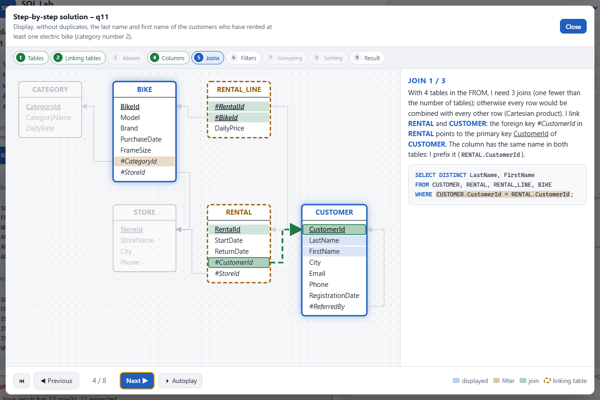

# Teacher, trainer

## Use it in class as is
There is nothing to install. Give your students the link to the app, or a direct link to a
question: `https://edu-fpar.github.io/sql-lab/?lang=en#demo-en/q11`. The
<i class="i i-link"></i> button next to the question number copies that link. The app offers:

- an English demo exercise and 18 French exam-based exercises, with about 450 SQL questions;
- schema and process questions.

It works on computers and phones.

## Project a solution in class
The **step-by-step solution** is designed to be projected. You move with the keyboard (← →),
discuss each step, and the timeline shows where you are. The full-size diagram (<i class="i i-maximize-2"></i>) and
draggable tables help explain joins.

## Add questions
In the **[teacher space](https://edu-fpar.github.io/sql-lab/create.html?lang=en)**:

1. Choose the database, topics, level and number of questions → **Copy the prompt**.
2. Paste it into your AI (ChatGPT, Claude, Mistral, Gemini…), then paste its reply.
3. Every solution query is **run on the database**: errors, empty results and unchecked sort
   orders are flagged. You edit, and add schema questions (drawn with the same editor as the
   students) or process questions.

See [Extra questions and AI](en/topics/ai-questions).

## Use my own database
In the teacher space, choose **"＋ Load my database (.zip, .sqlite, .sql)…"** and provide a `.sqlite` or `.sql` file
(CREATE TABLE + INSERT). The prompt and the checks then work on your database. Share it as a
**complete exercise (.zip)**. See [Custom databases](en/topics/databases).

## Share with my students
Four options, detailed in [Sharing and platforms](en/topics/sharing):

- a JSON file;
- a link without a server, where the questions are in the link;
- a link to a hosted file, updated each time it is opened;
- a complete exercise as a zip.

## Grade in Moodle (or another LMS)
**SCORM package** button in step 4 of the teacher space, then in Moodle *Add an activity →
SCORM package*. The grade is the percentage of questions solved. You can set a pass threshold,
and the platform resumes the student's progress. See [SCORM](en/topics/scorm).

## Adapt a solution
The step-by-step comments are generated automatically. To replace one, add a field to the
question: `"cinema": { "passages": "Your explanation…" }`. A question can also accept several
solutions (`variantes`).

