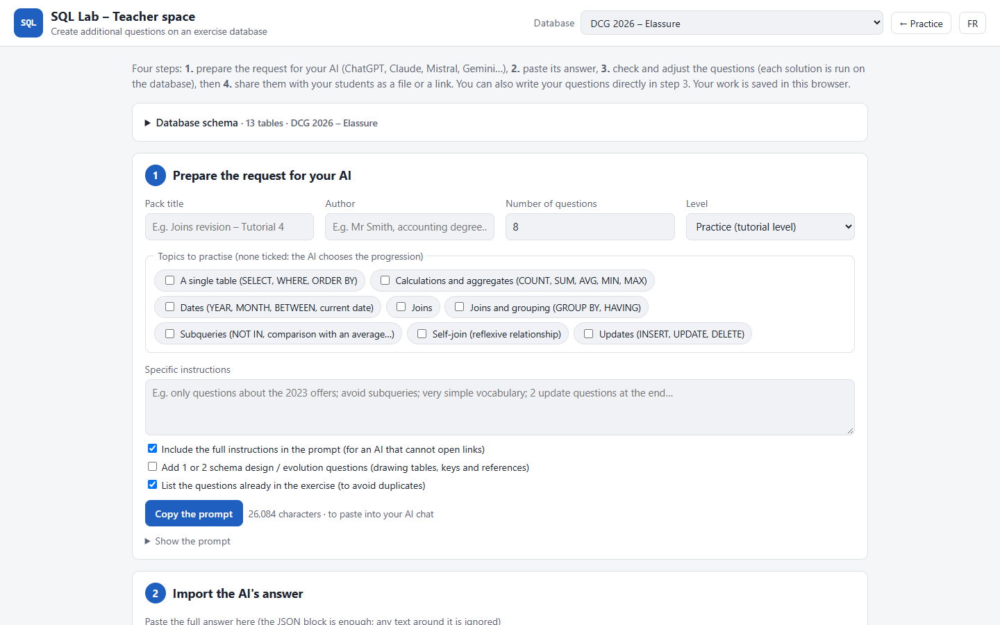

# Extra questions and AI

- **Ready-to-copy prompt**, which contains:
  - the format guide ([skill](https://github.com/edu-fpar/sql-lab/blob/main/skill/sql-lab-questions/SKILL.md), in French);
  - an automatic description of the database (tables, keys, value ranges and lists).
- **Each question is checked**:
  - the solution runs;
  - the result is not empty;
  - the requested sort is checked;
  - alternative solutions give the same result;
  - update queries have an effect.
- **Schema questions**: they are drawn in the editor, and the marking grid is derived from the
  drawing.

