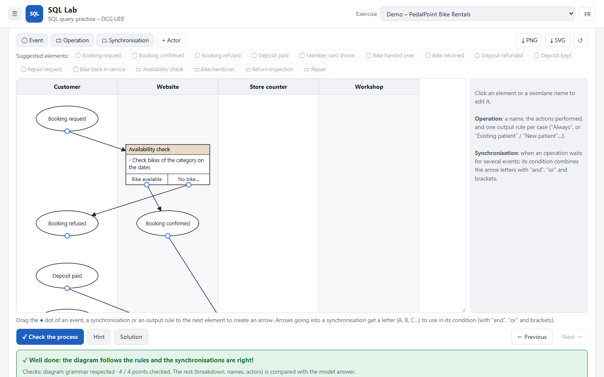

# Process diagrams

These are event-driven process diagrams in swimlanes: events, operations with output rules,
synchronisations.

- The **grammar** of the formalism and the **expected synchronisations** are checked
  automatically. An equivalent condition is accepted: "(C or B) and A" = "A and (B or C)".
- The rest is compared with the model answer through a self-assessment checklist.
- The diagram can be exported as PNG or SVG.

