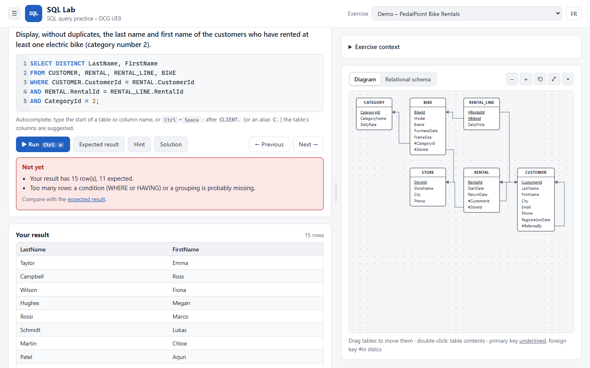
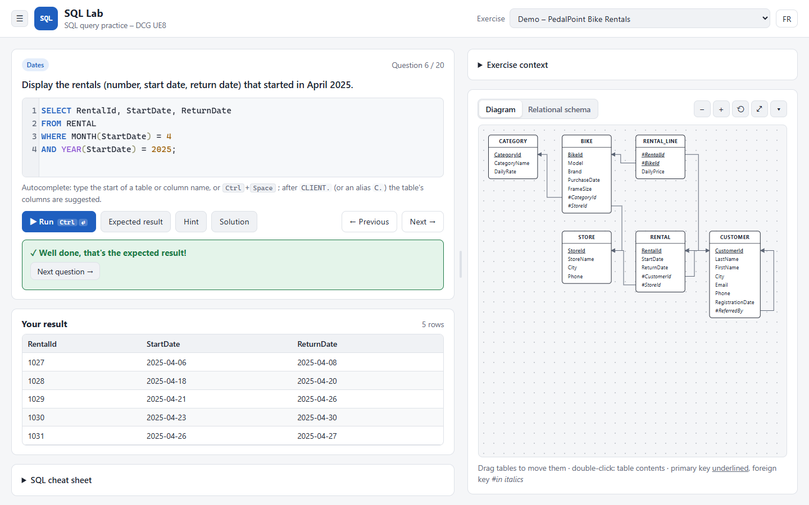

# Queries and automatic checking

- **Values are compared**, with tolerances:
  - column names (aliases) and column order are free;
  - extra columns are accepted;
  - case is ignored and numbers are rounded to 2 decimals.
- **Row order**: checked only when the question asks for sorting.
- **Both join styles** are accepted: in `WHERE`, or with `INNER JOIN … ON`.
- **Simulated update queries** (INSERT, UPDATE, DELETE): each run starts from a fresh copy of the
  database. The app shows the rows added, changed or deleted.
- **Exam-style dates** on SQLite: `YEAR()`, `MONTH()`, `DATEDIFF()`, `NOW()` (simulated "today"),
  `'2025-03-15'`, `'15/06/2024'`, `#15/06/2024#`.

