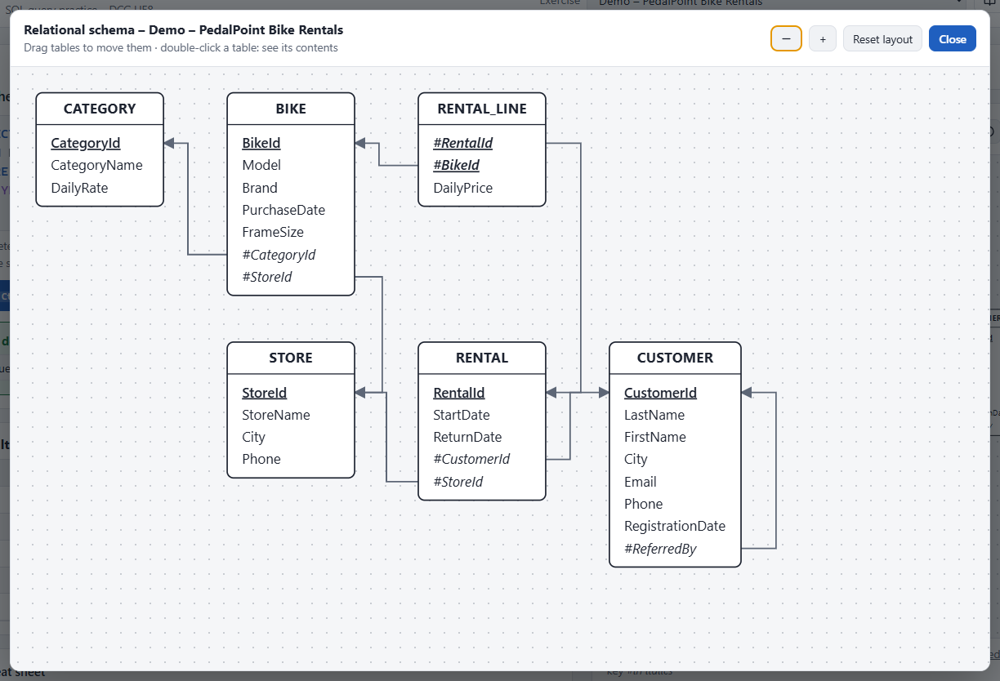
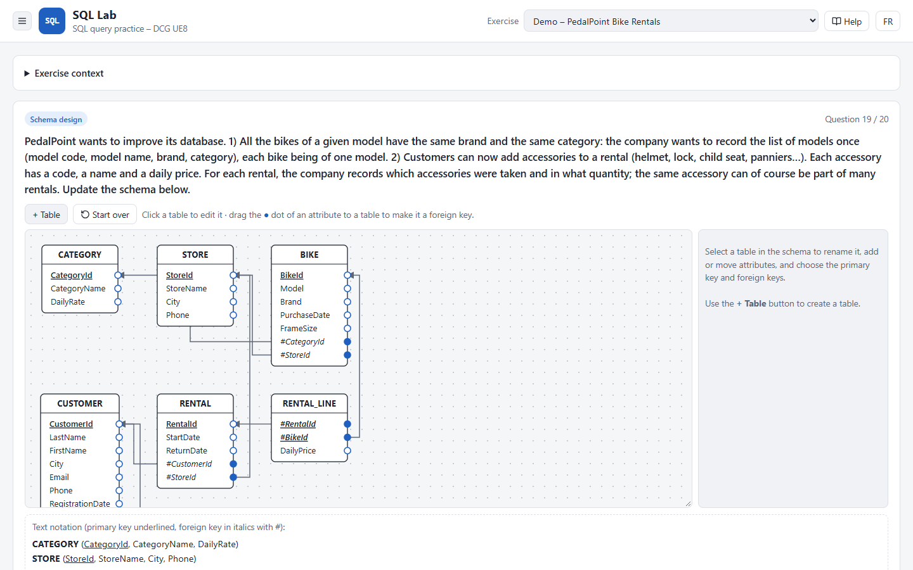

# Relational schema

- The diagram follows the French notation: primary key underlined, foreign key in italics with
  #, arrow to the primary key.
- Tables can be dragged with the mouse or a finger. Zoom, full-size view and a text notation tab
  are available.
- **Schema questions**: the student evolves a starting schema. The check compares the
  *structure*: tables, keys, references, attributes to remove. Equivalent names are accepted,
  and a table is recognised by its primary key.

