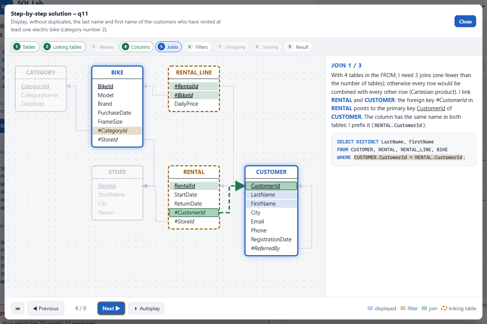
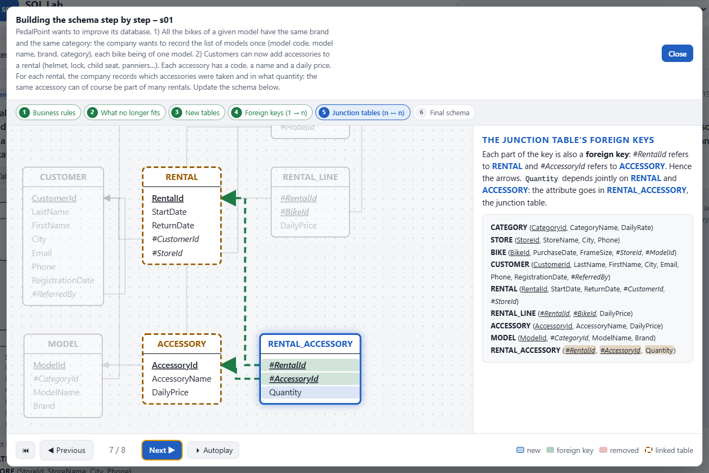

# Step-by-step solutions

The steps are generated automatically from the solution: the teacher has nothing to write.

- **SQL**: obvious tables, linking tables, aliases, columns, joins, filters, grouping, sorting,
  result. Update queries follow their own sequence (table, values, targeted rows).
- **Schema**: business rules, what no longer fits, new tables, foreign keys (one-to-many),
  junction tables (many-to-many), final schema.
- **Display**: a timeline of steps, an animated diagram, the query or schema built
  progressively, autoplay.

