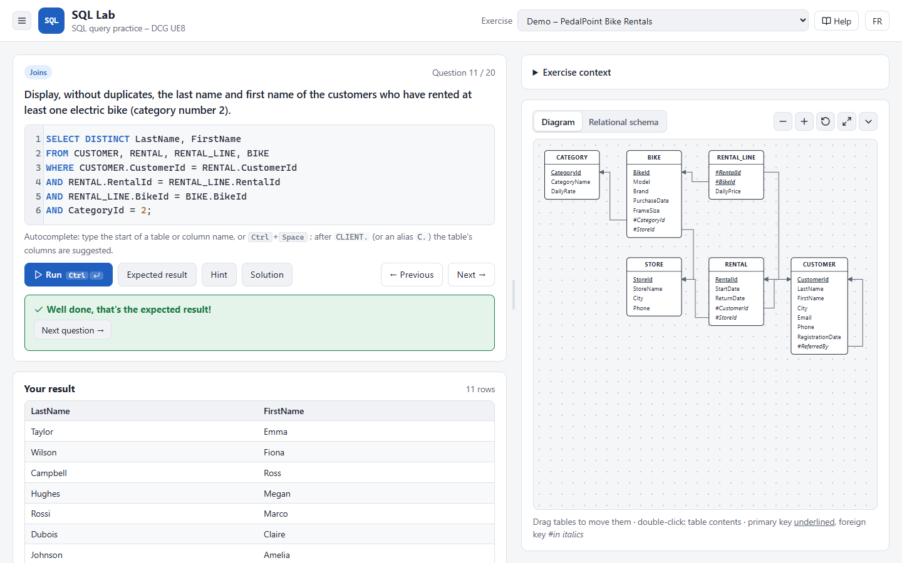

# Documentación de SQL Lab

**[Abrir la aplicación (demo en español)](https://edu-fpar.github.io/sql-lab/?lang=es#demo-es/intro)** ·
[Espacio del profesor](https://edu-fpar.github.io/sql-lab/create.html?lang=es) ·
[Código fuente](https://github.com/edu-fpar/sql-lab)

SQL Lab es una aplicación web para practicar SQL, pensada para estudiantes de gestión y
empresa. Las consultas se ejecutan **en el navegador**: nada que instalar, sin cuenta, sin
enviar datos a ningún sitio. Ofrece:

- un ejercicio de demostración en español y 18 ejercicios de los exámenes franceses de
  contabilidad DCG (2008–2026), con unas 450 preguntas de SQL;
- preguntas de diseño de esquemas y de procesos;
- soluciones paso a paso animadas;
- un espacio del profesor para crear preguntas con IA, usar tu propia base de datos y exportar
  a SCORM.

## ¿Quién eres?

  <a href="#/es/profiles/student"><b><i class="i i-graduation-cap"></i> Estudiante</b>Ponerme a prueba en SQL, entender mis errores, repetir una solución paso a paso.</a>
  <a href="#/es/profiles/teacher"><b><i class="i i-presentation"></i> Profesor, formador</b>Usarlo en clase, añadir preguntas, usar mi propia base de datos, calificar en Moodle.</a>
  <a href="#/es/profiles/institution"><b><i class="i i-school"></i> Centro educativo</b>Desplegarlo en el LMS, alojarlo internamente, cumplir el RGPD.</a>
  <a href="#/es/profiles/researcher"><b><i class="i i-microscope"></i> Docente universitario, investigador</b>Citar este software, usarlo en un estudio, adaptarlo.</a>
  <a href="#/es/profiles/edtech"><b><i class="i i-building-2"></i> EdTech, editorial</b>Integrarlo en mi producto, licencia comercial, ejercicios a medida.</a>
  <a href="#/es/profiles/developer"><b><i class="i i-code-xml"></i> Desarrollador</b>Ejecutarlo en local, añadir un ejercicio, traducir, informar de un problema.</a>

## Por tema

| Tema | En resumen |
|---|---|
| [Consultas y corrección automática](es/topics/queries) | tolerancias, diagnósticos, actualizaciones simuladas, fechas estilo examen |
| [Esquema relacional](es/topics/schema) | diagrama en notación francesa, preguntas de diseño de esquemas |
| [Diagramas de procesos](es/topics/process) | diagramas de eventos y resultados, sincronizaciones comprobadas |
| [Soluciones paso a paso](es/topics/step-by-step) | el razonamiento reproducido, diagrama animado |
| [Preguntas adicionales e IA](es/topics/ai-questions) | prompt listo para copiar, cada pregunta comprobada |
| [Bases de datos propias](es/topics/databases) | `.sqlite`, `.sql` o zip de ejercicio |
| [Compartir y plataformas](es/topics/sharing) | archivo, enlace, zip, SCORM |
| [SCORM](es/topics/scorm) | nota, estado y reanudación en Moodle, Chamilo… |
| [Idiomas](es/topics/languages) | interfaz en francés, inglés y español |
| [Privacidad y seguridad](es/topics/privacy) | sin recogida de datos |
| [Licencia, cita, uso comercial](es/topics/license) | CC BY-NC-SA 4.0, licencia comercial previo acuerdo |
| [Visión técnica](es/topics/technical) | arquitectura, formatos, pruebas |

## Referencia

[Formatos de archivo y herramientas](es/reference/) para ir más allá.
