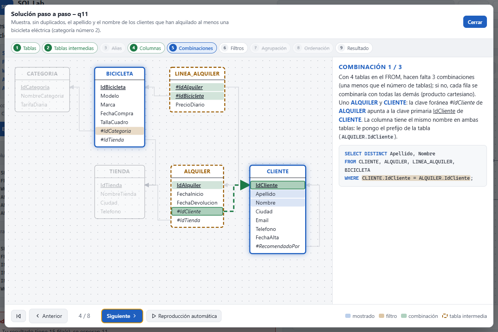

# Profesor, formador

## Usarlo en clase tal cual
No hay nada que instalar. Da a tus estudiantes el enlace a la aplicación, o un enlace directo a
una pregunta: `https://edu-fpar.github.io/sql-lab/?lang=es#demo-es/q11`. El botón
<i class="i i-link"></i> junto al número de la pregunta copia ese enlace. La aplicación ofrece:

- un ejercicio de demostración en español y 18 ejercicios basados en exámenes franceses, con
  unas 450 preguntas de SQL;
- preguntas de esquema y de procesos.

Funciona en ordenadores y en móviles.

## Proyectar una solución en clase
La **solución paso a paso** está pensada para proyectarse. Avanzas con el teclado (← →),
comentas cada paso y la línea de tiempo muestra dónde estás. El diagrama a pantalla completa
(<i class="i i-maximize-2"></i>) y las tablas que se pueden arrastrar ayudan a explicar las
combinaciones.

## Añadir preguntas
En el **[espacio del profesor](https://edu-fpar.github.io/sql-lab/create.html?lang=es)**:

1. Elige la base de datos, los temas, el nivel y el número de preguntas → **Copiar el prompt**.
2. Pégalo en tu IA (ChatGPT, Claude, Mistral, Gemini…) y después pega su respuesta.
3. Cada consulta de solución **se ejecuta en la base de datos**: se señalan los errores, los
   resultados vacíos y los órdenes no comprobados. Tú editas, y añades preguntas de esquema
   (dibujadas con el mismo editor que los estudiantes) o de procesos.

Consulta [Preguntas adicionales e IA](es/topics/ai-questions).

## Usar mi propia base de datos
En el espacio del profesor, elige **«＋ Cargar mi base de datos (.zip, .sqlite, .sql)…»** y
proporciona un archivo `.sqlite` o `.sql` (CREATE TABLE + INSERT). El prompt y las
comprobaciones funcionan entonces sobre tu base de datos. Compártela como **ejercicio completo
(.zip)**. Consulta [Bases de datos propias](es/topics/databases).

## Compartir con mis estudiantes
Cuatro opciones, detalladas en [Compartir y plataformas](es/topics/sharing):

- un archivo JSON;
- un enlace sin servidor, en el que las preguntas van dentro del enlace;
- un enlace a un archivo alojado, actualizado cada vez que se abre;
- un ejercicio completo en zip.

## Calificar en Moodle (u otro LMS)
Botón **Paquete SCORM** en el paso 4 del espacio del profesor y, después, en Moodle *Añadir una
actividad → Paquete SCORM*. La nota es el porcentaje de preguntas resueltas. Puedes fijar un
umbral de aprobado, y la plataforma retoma el progreso del estudiante. Consulta [SCORM](es/topics/scorm).

## Adaptar una solución
Los comentarios de la solución paso a paso se generan automáticamente. Para sustituir uno,
añade un campo a la pregunta: `"cinema": { "passages": "Tu explicación…" }`. Una pregunta
también puede aceptar varias soluciones (`variantes`).

