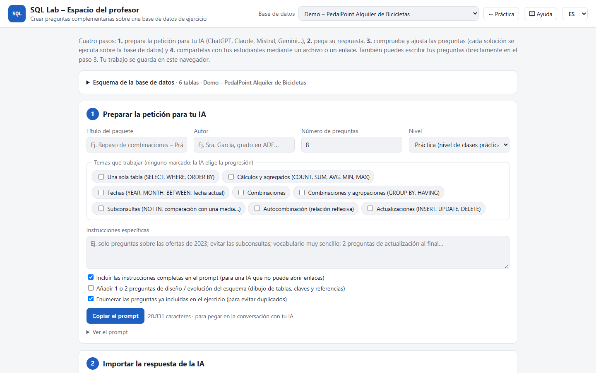

# Preguntas adicionales e IA

- **Prompt listo para copiar**, que contiene:
  - la guía de formato ([skill](https://github.com/edu-fpar/sql-lab/blob/main/skill/sql-lab-questions/SKILL.md), en francés);
  - una descripción automática de la base de datos (tablas, claves, rangos y listas de valores).
- **Cada pregunta se comprueba**:
  - la solución se ejecuta;
  - el resultado no está vacío;
  - se comprueba el orden pedido;
  - las soluciones alternativas dan el mismo resultado;
  - las consultas de actualización tienen efecto.
- **Preguntas de esquema**: se dibujan en el editor, y la plantilla de corrección se deduce del
  dibujo.

