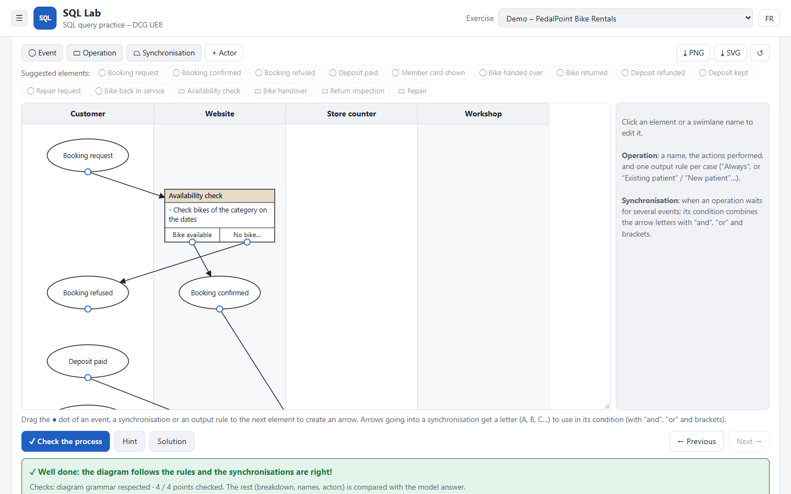

# Diagramas de procesos

Son diagramas de eventos y resultados organizados en calles: eventos, operaciones con reglas de
emisión, sincronizaciones.

- La **gramática** del formalismo y las **sincronizaciones esperadas** se comprueban
  automáticamente. Se acepta una condición equivalente: «(C o B) y A» = «A y (B o C)».
- El resto se compara con la solución modelo mediante una lista de autoevaluación.
- El diagrama se puede exportar en PNG o SVG.

