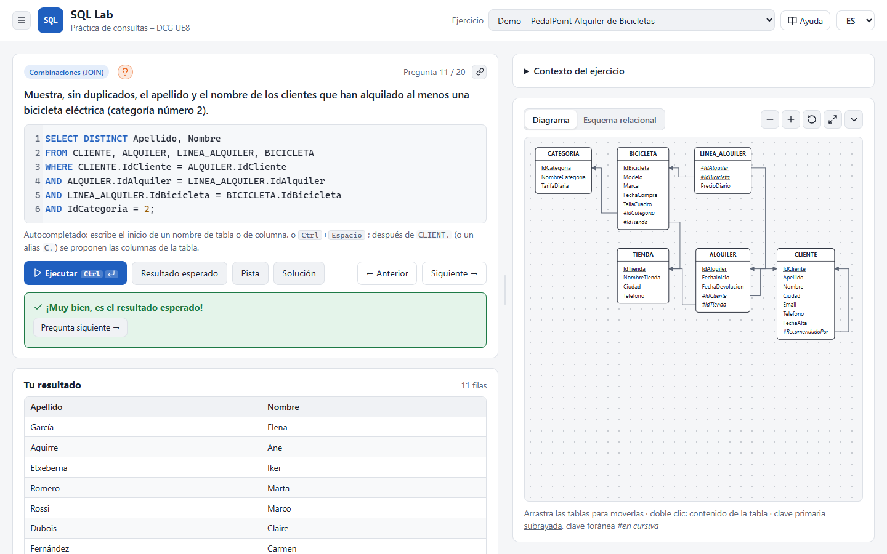
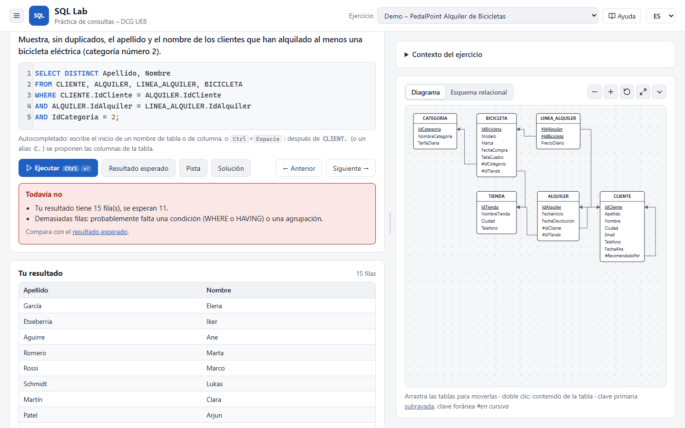
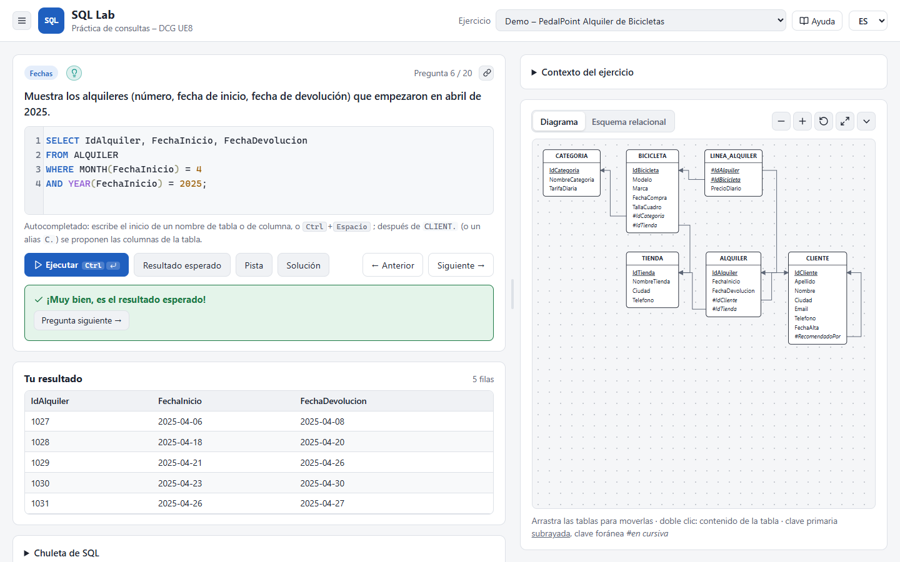

# Consultas y corrección automática

- **Se comparan los valores**, con tolerancias:
  - los nombres de columna (alias) y el orden de las columnas son libres;
  - se aceptan columnas adicionales;
  - se ignoran mayúsculas y minúsculas, y los números se redondean a 2 decimales.
- **Orden de las filas**: solo se comprueba cuando la pregunta pide ordenar.
- **Se aceptan los dos estilos de combinación**: en el `WHERE` o con `INNER JOIN … ON`.
- **Consultas de actualización simuladas** (INSERT, UPDATE, DELETE): cada ejecución parte de una
  copia nueva de la base de datos. La aplicación muestra las filas añadidas, modificadas o
  eliminadas.
- **Fechas estilo examen** en SQLite: `YEAR()`, `MONTH()`, `DATEDIFF()`, `NOW()` («hoy»
  simulado), `'2025-03-15'`, `'15/06/2024'`, `#15/06/2024#`.

