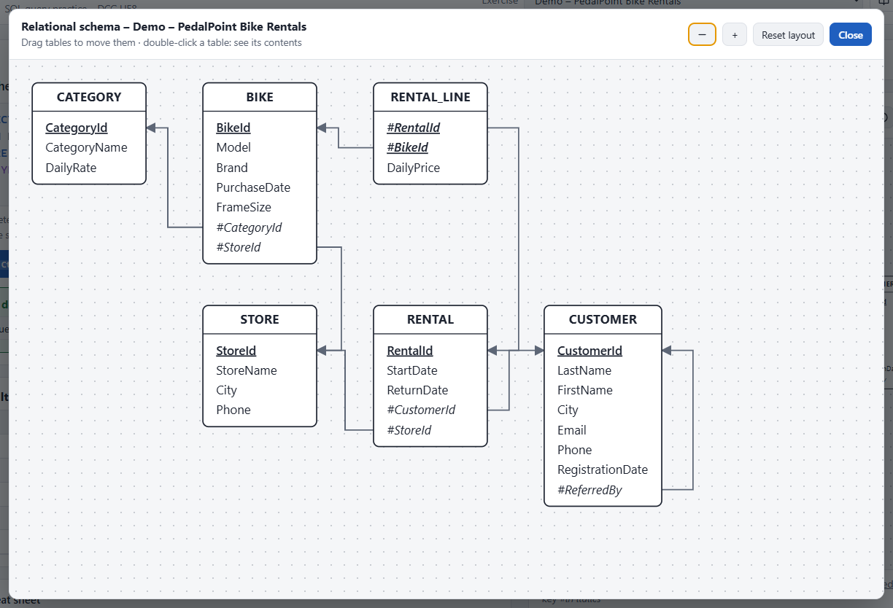
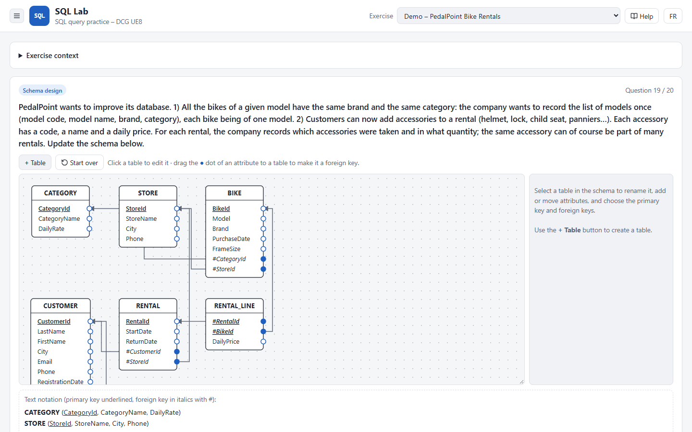

# Esquema relacional

- El diagrama sigue la notación francesa: clave primaria subrayada, clave foránea en cursiva con
  #, flecha hacia la clave primaria.
- Las tablas se pueden arrastrar con el ratón o con el dedo. Hay zoom, vista a pantalla completa
  y una pestaña con la notación textual.
- **Preguntas de esquema**: el estudiante hace evolucionar un esquema de partida. La comprobación
  compara la *estructura*: tablas, claves, referencias, atributos que hay que retirar. Se aceptan
  nombres equivalentes, y una tabla se reconoce por su clave primaria.

