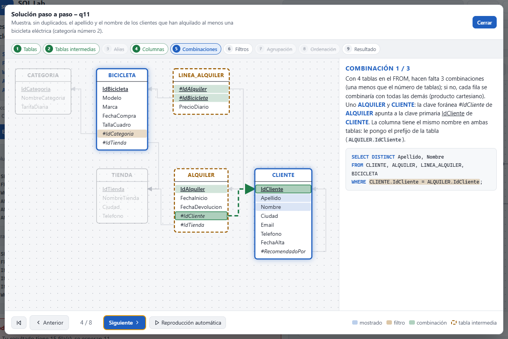
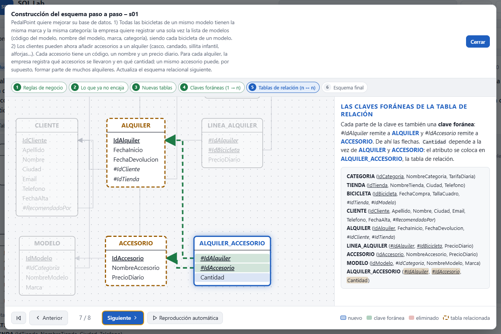

# Soluciones paso a paso

Los pasos se generan automáticamente a partir de la solución: el profesor no tiene que escribir
nada.

- **SQL**: tablas evidentes, tablas intermedias, alias, columnas, combinaciones, filtros,
  agrupación, orden, resultado. Las consultas de actualización siguen su propia secuencia
  (tabla, valores, filas afectadas).
- **Esquema**: reglas de negocio, lo que ya no encaja, tablas nuevas, claves foráneas (uno a
  varios), tablas de relación (varios a varios), esquema final.
- **Presentación**: una línea de tiempo de pasos, un diagrama animado, la consulta o el esquema
  construidos progresivamente, reproducción automática.

