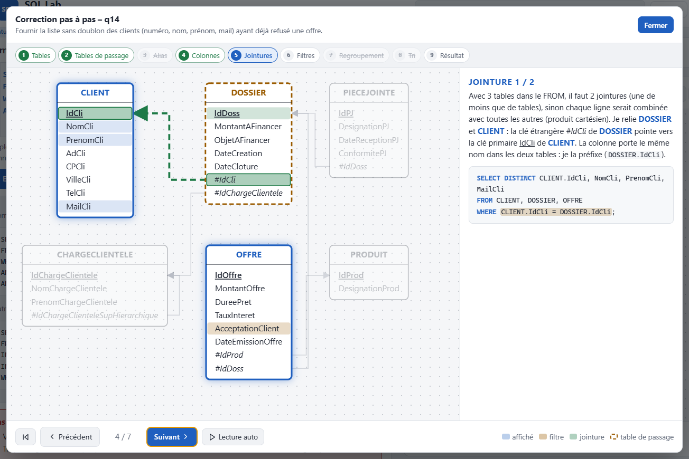

# Enseignant, formateur

## L'utiliser en cours tel quel
Il n'y a rien à installer. Donnez à vos étudiants le lien de l'application, ou un lien direct
vers une question : `https://edu-fpar.github.io/sql-lab/#dcg2024/q14`. Le bouton
<i class="i i-link"></i> à côté du numéro de la question copie ce lien. L'application propose :

- 18 exercices tirés des annales du DCG, avec environ 450 questions SQL ;
- au moins une question de schéma par exercice, et des questions de processus.

L'application marche sur ordinateur et sur téléphone.

## Projeter une correction en classe
La **correction pas à pas** est faite pour être projetée. On avance au clavier (← →), on
discute de chaque étape, et la frise montre où l'on en est. Le diagramme agrandi (bouton <i class="i i-maximize-2"></i>)
et le déplacement des tables aident à expliquer les jointures.

## Ajouter des questions
Dans l'**[espace enseignant](https://edu-fpar.github.io/sql-lab/create.html)** :

1. Choisissez la base, les thèmes, le niveau et le nombre de questions → **Copier le prompt**.
2. Collez-le dans votre IA (ChatGPT, Claude, Mistral, Gemini…), puis collez sa réponse.
3. Chaque correction est **exécutée sur la base** : les erreurs, les résultats vides et les tris
   non vérifiés sont signalés. Vous retouchez, vous ajoutez des questions de schéma (dessinées
   avec le même éditeur que les étudiants) ou de processus.

Voir [Questions complémentaires et IA](themes/questions-ia).

## Utiliser ma propre base de données
Dans l'espace enseignant, choisissez **« ＋ Charger ma base (.zip, .sqlite, .sql)… »** et donnez un fichier `.sqlite`
ou `.sql` (CREATE TABLE + INSERT). Le prompt et la vérification fonctionnent alors sur votre
base. Partagez ensuite un **exercice complet (.zip)**. Voir [Bases personnelles](themes/bases).

## Partager avec mes étudiants
Quatre possibilités, détaillées dans [Partage et plateformes](themes/partage) :

- un fichier JSON ;
- un lien sans serveur, où les questions sont dans le lien ;
- un lien vers un fichier hébergé, mis à jour à chaque ouverture ;
- un exercice complet en zip.

## Noter dans Moodle (ou un autre LMS)
Bouton **Paquet SCORM** à l'étape 4 de l'espace enseignant, puis dans Moodle *Ajouter une
activité → Paquetage SCORM*. La note correspond au pourcentage de questions réussies. Vous
pouvez fixer un seuil de réussite, et la plateforme reprend la progression de l'étudiant.
Voir [SCORM](themes/scorm).

## Adapter une correction
Les commentaires de la correction pas à pas sont générés automatiquement. Pour en remplacer un,
ajoutez à la question un champ `"cinema": { "passages": "Votre explication…" }`. Une question
peut aussi avoir plusieurs corrections acceptées (`variantes`).

