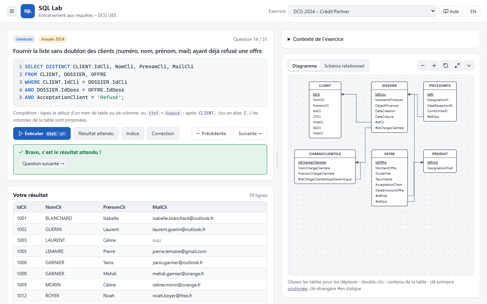

# Étudiant

## Me tester sur le SQL
1. Ouvrez l'[application](https://edu-fpar.github.io/sql-lab/) et choisissez un exercice
   (une annale du DCG, de 2008 à 2026).
2. Lisez la **question 0 « Présentation »** : contexte de l'entreprise, tables, méthode.
3. Écrivez votre requête dans l'éditeur (la complétion propose les tables et les colonnes),
   puis **Exécuter** (Ctrl + Entrée). L'application compare votre résultat au résultat attendu.

Les questions vont du plus simple au plus difficile : une table, calculs, dates, jointures,
regroupements, sous-requêtes, mises à jour, puis schéma et processus.
Voir [Requêtes et correction automatique](themes/requetes).

## Revoir le cours
À côté de chaque thème de la liste des questions (et du badge de la question), l'icône
<i class="i i-lightbulb"></i> ouvre un **rappel de cours** visuel :

- la méthode en étapes que l'on déplie une à une ;
- les notions et subtilités en « pétales » ;
- les pièges classiques, avec l'écriture fausse et l'écriture juste.

Le bouton **Tout déplier** affiche tout d'un coup, pour réviser ou imprimer.

## Comprendre mes erreurs
- Le message ne dit pas seulement « faux » : il explique ce qui cloche. Par exemple : trop de
  lignes (jointure ou condition oubliée), des doublons (DISTINCT), un mauvais tri, `= NULL` au
  lieu de `IS NULL`, une condition sur un calcul placée dans WHERE au lieu de HAVING.
- Les erreurs de syntaxe de SQLite sont traduites en conseils, par exemple « colonne
  ambiguë : préfixez-la avec le nom de la table ».
- **Résultat attendu** affiche ce qu'il fallait obtenir, **Indice** donne un coup de pouce sans
  la réponse, et un double-clic sur une table du diagramme montre son contenu.

## Revoir une correction pas à pas
Dans **Correction**, le bouton **<i class="i i-clapperboard"></i> Correction pas à pas** rejoue le raisonnement :

- d'abord les tables qui contiennent l'information ;
- puis les tables de passage, les alias, les colonnes à afficher, les jointures, les filtres,
  le regroupement et le tri.

Le schéma s'anime et la requête se construit morceau par morceau. Vous pouvez avancer étape
par étape ou lancer la lecture automatique. Voir [Correction pas à pas](themes/pas-a-pas).

## M'entraîner au schéma relationnel et aux processus
- **Questions de schéma** : faites évoluer le schéma de départ (ajoutez des tables, déplacez des
  attributs, tracez les clés étrangères en tirant le rond ●), puis **Vérifier le schéma**.
  Le bouton **<i class="i i-clapperboard"></i> Construction pas à pas** de la correction montre comment raisonner.
- **Questions de processus** : dessinez le schéma événements-résultats (événements, opérations,
  synchronisations). Les synchronisations sont vérifiées automatiquement ; une liste
  d'auto-évaluation vous aide à comparer le reste avec le corrigé.

## Reprendre où j'en étais
La progression et vos brouillons sont gardés **dans votre navigateur**, sur votre appareil.
Sur un autre ordinateur, ou en navigation privée, vous repartez de zéro. Dans Moodle (paquet
SCORM), c'est la plateforme qui garde votre progression.

## Faire les questions données par mon professeur
Votre professeur vous donne un **lien** (ouvrez-le simplement) ou un **fichier** (menu <i class="i i-menu"></i> →
*Importer un fichier*). Ses questions s'ajoutent à la fin de la liste (groupe <i class="i i-star"></i>).

