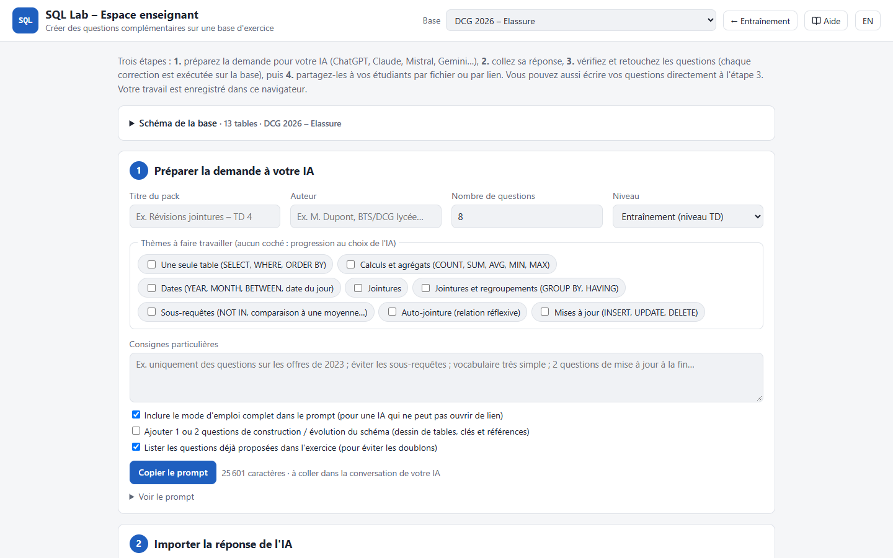

# Questions complémentaires (packs)

Un enseignant peut ajouter ses propres questions sur une base existante, sans toucher au dépôt.

**Espace enseignant : `create.html`** (lien « Créer des questions » dans le menu)

1. *Préparer la demande à votre IA* : titre, nombre de questions, thèmes, niveau, consignes →
   bouton **Copier le prompt**. Le prompt contient le lien vers la skill
   [`skill/sql-lab-questions/SKILL.md`](https://github.com/edu-fpar/sql-lab/blob/main/skill/sql-lab-questions/SKILL.md) (format JSON et règles
   de rédaction), son contenu (pour les IA qui n'ouvrent pas les liens), et une description
   détaillée de la base générée automatiquement : tables, colonnes, clés, plages de valeurs,
   listes de valeurs, exemples. N'importe quelle IA convient (ChatGPT, Claude, Mistral, Gemini…).
2. *Importer la réponse* : coller la réponse de l'IA (le bloc JSON est extrait du texte), ou
   ouvrir un fichier, ou partir d'un pack vide.
3. *Vérifier et retravailler* : chaque correction est exécutée sur la base ; erreurs et points à
   relire sont signalés (colonne inconnue, résultat vide, ORDER BY sans ordre vérifié, variante
   qui ne donne pas le même résultat, modification sans effet…). Édition, tri, duplication,
   colonnes de tri à cocher sur le résultat. Brouillon enregistré dans le navigateur.
4. *Partager* :
   - **fichier JSON** à déposer sur Moodle ou envoyer ; l'étudiant fait « Importer un fichier » ;
   - **lien sans serveur** : `index.html#pack=…`, les questions sont compressées dans le lien
     (après le `#`, donc jamais envoyées au serveur) ; environ 1 300 caractères pour 5 questions ;
   - **lien vers un fichier hébergé** : `index.html?pack=https://…/questions.json`
     (GitHub, Gist « raw »… : le site doit autoriser CORS). Les étudiants récupèrent la dernière
     version à chaque ouverture du lien.

Côté étudiant, les questions importées s'ajoutent en fin de liste (groupe <i class="i i-star"></i>), sont conservées dans
le navigateur et peuvent être retirées. Un pack de même titre et même auteur remplace le précédent.
Les corrections importées ne s'exécutent que dans la base en mémoire du navigateur, et tous les
textes sont affichés comme du texte : un fichier malveillant ne peut rien abîmer.

Format : voir la skill ; exemple dans [`exemples/pack-exemple-dcg2024.json`](https://github.com/edu-fpar/sql-lab/blob/main/exemples/pack-exemple-dcg2024.json).
Vérification en ligne de commande : `node tools/test_pack.js <fichier.json>`.
