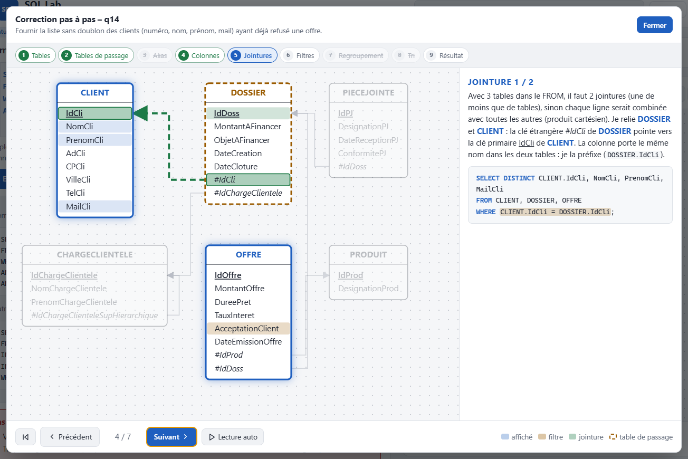
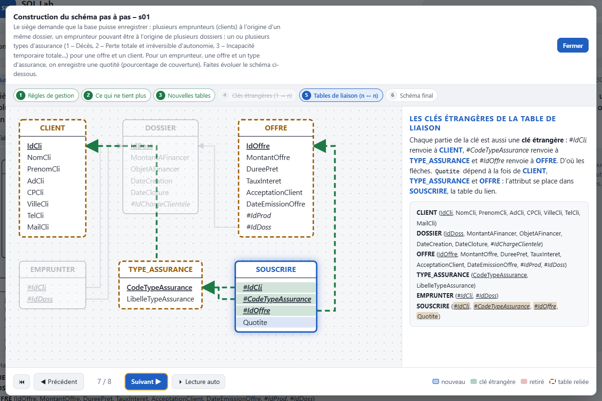

# Correction pas à pas

Dans la correction d'une question SQL, le bouton **<i class="i i-clapperboard"></i> Correction pas à pas** rejoue le
raisonnement, dans l'ordre où on le mène (qui n'est pas l'ordre d'écriture) : tables évidentes →
tables de passage → alias → colonnes à afficher → jointures → filtres → regroupement → tri →
résultat. Une frise montre où l'on en est (les phases inutiles pour la requête sont barrées), le
diagramme s'anime (tables allumées, tables de passage en pointillés, colonnes surlignées par rôle,
flèche de la jointure en cours) et la requête se construit morceau par morceau. Les requêtes de
mise à jour ont leur propre déroulé : table, valeurs, lignes visées, résultat.



Les questions de **schéma** ont le même mode (**<i class="i i-clapperboard"></i> Construction pas à pas**) : règles de gestion →
ce qui ne tient plus (colonne barrée) → nouvelles tables → clés étrangères (relation un à
plusieurs) → tables de liaison (plusieurs à plusieurs, clé composée puis flèches) → schéma final.
Le diagramme évolue à chaque étape.



Rien à écrire : les étapes sont **générées à partir de la correction** (ou de la solution du
schéma) par `assets/cinema.js`.
**Correction commentée.** Pour quelques questions choisies (une par thème dans chaque exercice,
et toutes les questions de schéma), l'enseignant ajoute ses propres commentaires avec le champ
facultatif `cinema`. La question est alors marquée d'un clap dans la liste, et le bouton devient
« Correction commentée pas à pas ».

```json
"cinema": {
  "+tables": "C'est le mot « responsable » qui indique le chemin : le dossier connaît son chargé.",
  "+jointures.2": "Une jointure **par flèche traversée**, jamais de raccourci.",
  "lecture": "- Règle 1 : un dossier a **plusieurs** emprunteurs → table de liaison\n- Règle 2 : …"
}
```

- `+phase` ou `+phase.n` **ajoute** un encadré « Point de méthode » sous le commentaire automatique
  (première étape de la phase, ou la n-ième) ;
- `phase` ou `phase.n` **remplace** le commentaire automatique ;
- texte brut, avec `**gras**`, `` `code` `` et des lignes `- ` pour une liste.

Phases SQL : `tables`, `passages`, `alias`, `select`, `jointures`, `filtres`, `groupe`, `tri`,
`resultat` (mises à jour : `table`, `valeurs`, `ciblage`). Phases schéma : `lecture`, `retraits`,
`entites`, `liens`, `associations`, `bilan`.

Outils : `node tools/cinema_plan.js <exercice> <question>` affiche les étapes générées et leurs clés ;
`node tools/set_cinema.js <exercice> <question> commentaires.json` écrit le champ sans reformater le
fichier ; `node tools/test_exercice.js` signale toute clé qui ne vise aucune étape.
