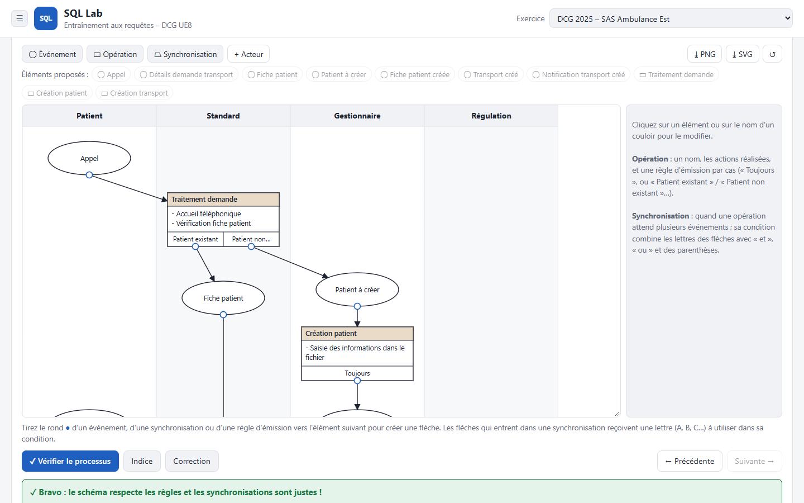

# Questions de processus

Espace d'entraînement au formalisme des annales : couloirs (acteurs) en colonnes, **événements**
(bulles), **opérations** (cases : nom, actions, règles d'émission), **synchronisations** (trapèzes
avec une condition « A et (B ou C) »). Les flèches se tirent depuis les ronds ● ; celles qui entrent
dans une synchronisation reçoivent une lettre automatiquement. Panneau de propriétés, éléments
proposés facultatifs, export du schéma en PNG ou SVG. Ces questions se placent en fin de série.

Vérification automatique, sans corrigé unique :
- **grammaire du formalisme** : une opération qui attend plusieurs événements passe par une
  synchronisation ; pas de flèche directe entre opérations ; chaque règle d'émission produit un
  événement ; la condition n'utilise que les lettres des flèches entrantes, et toutes ;
- **synchronisations attendues** : la logique de déclenchement est comparée à celle du corrigé sur
  toutes les combinaisons d'événements (« (C ou B) et A » = « A et (B ou C) ») ; nombre ou cas des
  règles d'émission d'une opération ;
- le reste (découpage, noms, acteurs) : corrigé affiché en lecture seule + liste d'auto-évaluation.

```json
{
  "id": "p01", "type": "processus", "theme": "Processus",
  "enonce": "…",
  "couloirs": ["Patient", "Standard", "Gestionnaire", "Régulation"],
  "elements": [ { "kind": "event", "label": "Appel" }, { "kind": "operation", "label": "Création transport" } ],
  "attendus": [
    { "operation": "Création transport", "alias": ["Créer transport"],
      "synchronisation": "Détails demande transport ET (Fiche patient OU Fiche patient créée)" },
    { "operation": "Traitement demande", "regles": ["Patient existant", "Patient non existant"] }
  ],
  "equivalents": { "Fiche patient créée": ["Patient créé"] },
  "solution": { "lanes": [], "nodes": [], "arrows": [] },
  "autoevaluation": ["…"]
}
```

`depart` (facultatif, même format que `solution`) : schéma partiel donné à compléter, comme les
annexes « à compléter » des sujets. `couloirs` absent : l'étudiant crée ses acteurs.
Dans une condition attendue, un nom d'événement qui contient « et » / « ou » se met entre
guillemets : `"Lundi ou jeudi" ET Dossier reçu`. Un événement que le corrigé tolère sans
l'exiger se déclare dans `"facultatifs": ["Relevés météo"]` (au niveau de l'attendu concerné). `elements` absent : pas d'éléments proposés.
Exemple : `dcg2025` (question `p01`). Pas encore d'édition dans l'espace de création : la solution
se dessine dans l'application puis se recopie depuis le brouillon (ou s'écrit dans le JSON).


