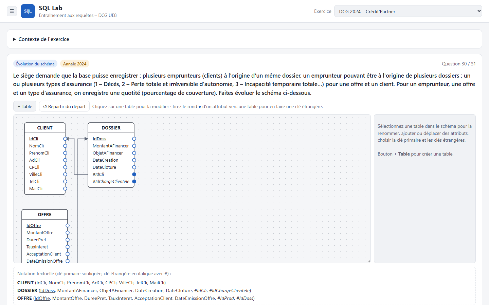

# Questions de schéma

Type de question sans SQL : l'étudiant fait évoluer un schéma de départ dans un éditeur graphique
(ajout, renommage et suppression de tables et d'attributs, déplacement d'un attribut vers une autre
table, clé primaire, clés étrangères tracées en tirant le rond ● d'un attribut vers une table) ;
un panneau de propriétés permet tout au clavier et sur téléphone, et la notation textuelle DCG se
met à jour en direct. La correction compare la **structure** à la solution et donne un diagnostic
ciblé (table manquante, attribut à retirer, clé composée attendue, flèche vers la mauvaise table…),
avec un score en points de contrôle.

```json
{
  "id": "s01", "type": "schema", "theme": "Évolution du schéma",
  "enonce": "…",
  "depart": ["CLIENT", "DOSSIER", "OFFRE"],
  "solution": { "tables": [
    { "nom": "DOSSIER", "interdits": ["IdCli"] },
    { "nom": "EMPRUNTER", "alias": ["EMPRUNT"], "role": "relier les emprunteurs et les dossiers",
      "pk": ["IdCli", "IdDoss"], "fk": { "IdCli": "CLIENT", "IdDoss": "DOSSIER" },
      "attributs": [], "optionnels": [] }
  ], "tablesOptionnelles": [], "tablesSupprimees": [] },
  "variantes": [ { "tables": [ … ] }, { "tables": [ … ], "partiel": "Message si réponse seulement en partie juste" } ],
  "indice": "…"
}
```

- `depart` : `"base"` (toute la base), une liste de tables de la base, ou des tables décrites :
  `{ "nom": "PERSONNEL", "colonnes": ["_NumPersonnel", "NomPersonnel", "#CodeSalon>SALON"] }`
  (`_` = clé primaire, `#…>TABLE` = clé étrangère).
- Noms comparés sans tenir compte de la casse, des accents ni des `_` ; équivalents d'un attribut
  séparés par `|` (`"NumPersonnelHydro|NumPersonnel"`) ; une table au nom imprévu est reconnue
  par sa clé primaire ; `role` sert au message « Il manque une table pour … ».
- Chaque base a au moins une question de schéma tirée de son annale (évolution demandée par le
  sujet, solution et variantes du corrigé, réponses « partiellement exactes »).
- Éviter les alias vagues communs à plusieurs tables (par ex. « TRAVAUX ») : la reconnaissance
  par le nom se ferait sur la mauvaise table ; une table au nom imprévu reste reconnue par sa clé.
- Un schéma identique au départ est toujours signalé « non modifié ».
- **Espace de création** : bouton « + Question de schéma » ; on coche les tables de départ, on
  **dessine la solution** avec le même éditeur que l'étudiant, et la grille de correction en est
  déduite (nouvelles tables, clés, références, attributs à retirer). Zones « Noms acceptés »
  (`EMPRUNTER = EMPRUNT, EMPRUNTEUR`, `SOUSCRIRE.Quotite = Pourcentage`) et « Rôle des nouvelles
  tables ». Les variantes se définissent dans le fichier JSON et sont conservées.
- La skill décrit ce format : l'IA peut proposer des questions de schéma (case à cocher du prompt).
- Tests : `node tools/test_exercice.js` vérifie que chaque solution est reconnue, que le schéma de
  départ seul est refusé, et que des erreurs typiques donnent le bon diagnostic.


