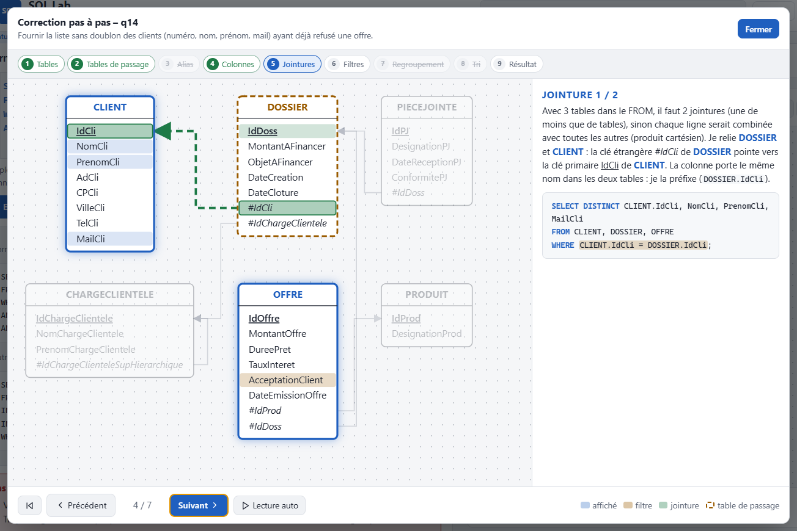
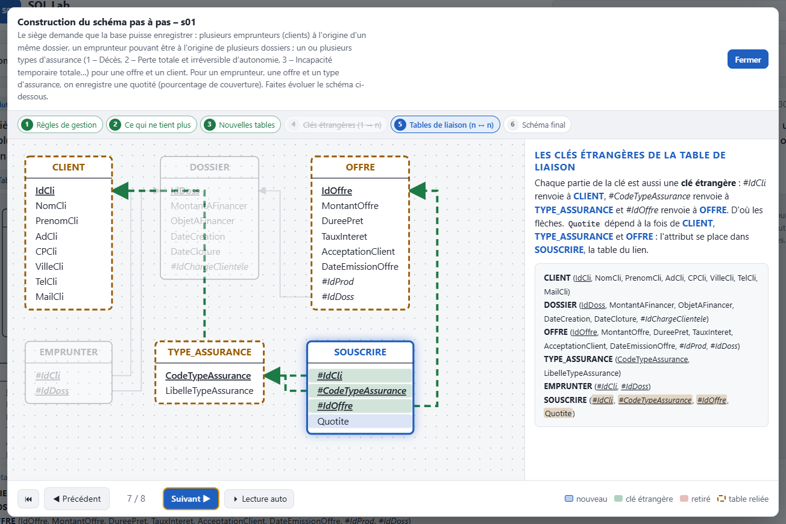

# Correction pas à pas

Les étapes sont générées automatiquement à partir de la correction : l'enseignant n'a rien à
écrire.

- **SQL** : tables évidentes, tables de passage, alias, colonnes, jointures, filtres,
  regroupement, tri, résultat. Les requêtes de mise à jour suivent leur propre déroulé (table,
  valeurs, lignes visées).
- **Schéma** : règles de gestion, ce qui ne tient plus, nouvelles tables, clés étrangères
  (un à plusieurs), tables de liaison (plusieurs à plusieurs), schéma final.
- **Affichage** : une frise des étapes, un diagramme animé, la requête ou le schéma construit
  progressivement, la lecture automatique.

