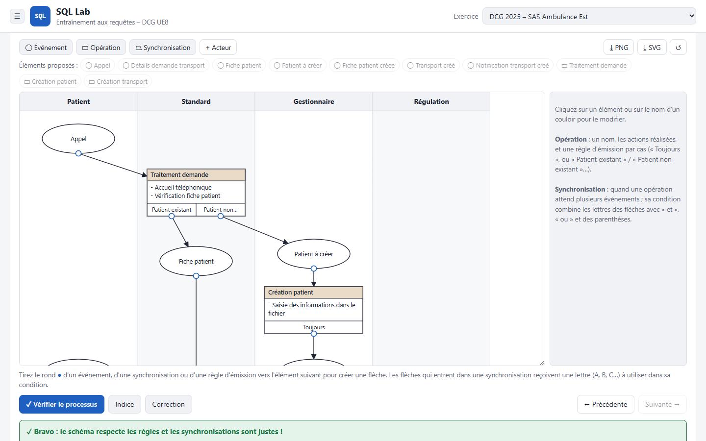

# Processus

Il s'agit des schémas événements-résultats en couloirs : événements, opérations avec règles
d'émission, synchronisations.

- La **grammaire** du formalisme et les **synchronisations attendues** sont vérifiées
  automatiquement. Une condition équivalente est acceptée : « (C ou B) et A » = « A et (B ou C) ».
- Le reste se compare au corrigé avec une liste d'auto-évaluation.
- Le schéma s'exporte en PNG ou en SVG.

