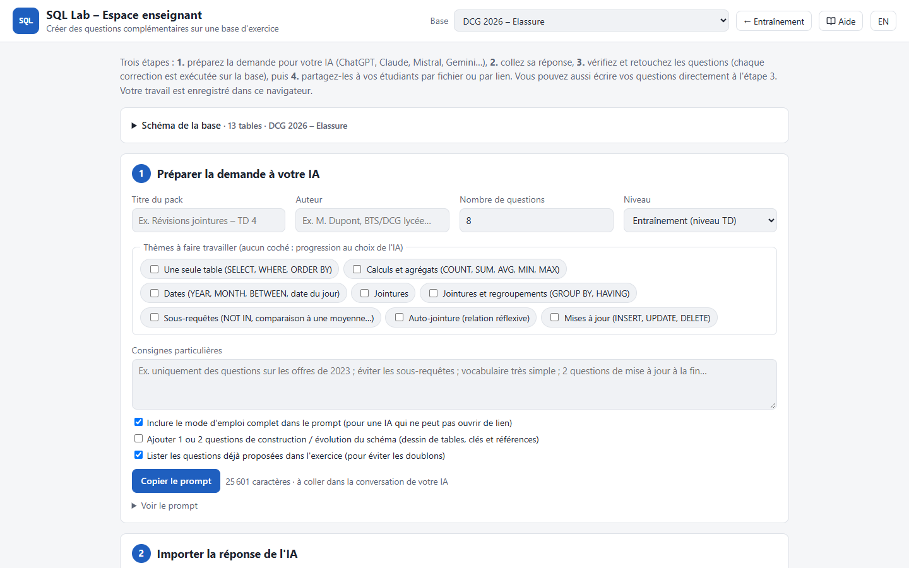

# Questions complémentaires et IA

- **Prompt prêt à copier**, qui contient :
  - le mode d'emploi du format ([skill](https://github.com/edu-fpar/sql-lab/blob/main/skill/sql-lab-questions/SKILL.md)) ;
  - une description de la base générée automatiquement (tables, clés, plages et listes de
    valeurs).
- **Vérification de chaque question** :
  - la correction s'exécute ;
  - le résultat n'est pas vide ;
  - le tri demandé est vérifié ;
  - les variantes donnent le même résultat ;
  - les mises à jour ont un effet.
- **Questions de schéma** : elles se dessinent dans l'éditeur, et la grille de correction en est
  déduite.

