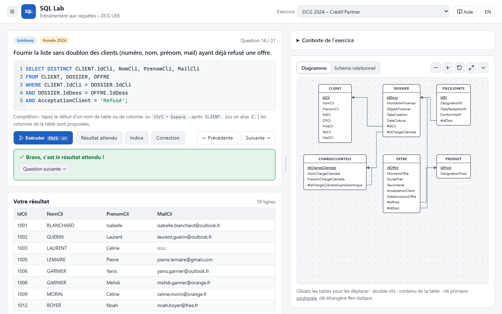
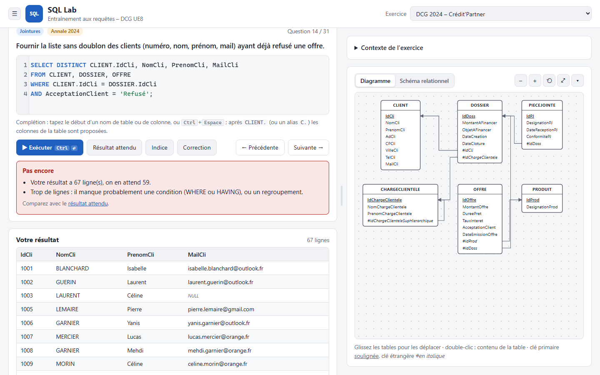
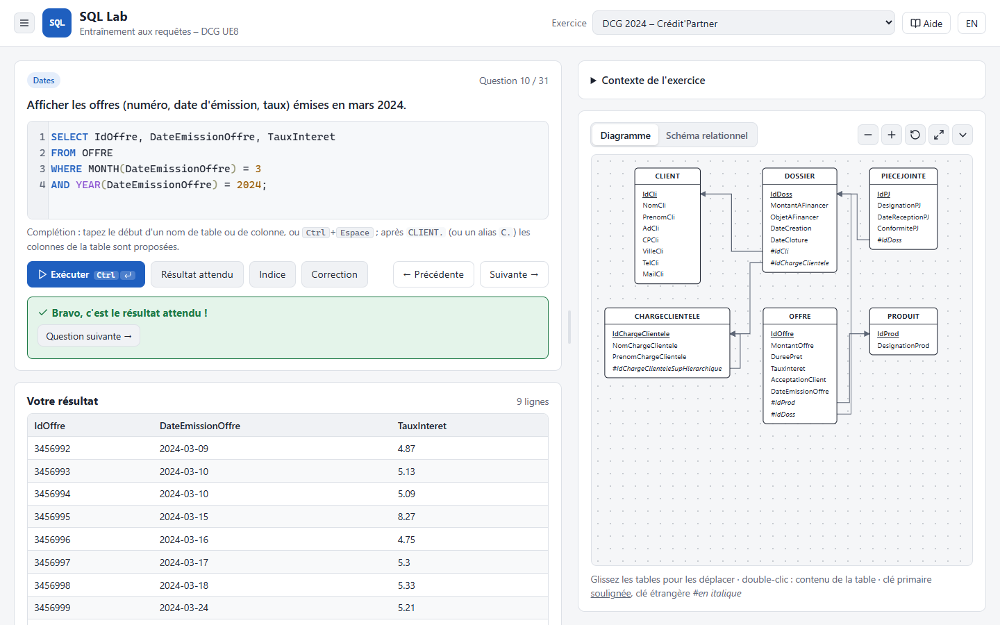

# Requêtes et correction automatique

- **Comparaison des valeurs**, avec des tolérances :
  - le nom des colonnes (alias) et leur ordre sont libres ;
  - les colonnes en trop sont acceptées ;
  - la casse est ignorée et les nombres sont arrondis à 2 décimales.
- **Ordre des lignes** : vérifié seulement quand l'énoncé demande un tri.
- **Deux écritures des jointures** acceptées : dans le `WHERE`, ou avec `INNER JOIN … ON`.
- **Requêtes de mise à jour fictives** (INSERT, UPDATE, DELETE) : chaque exécution repart d'une
  copie neuve de la base. L'application montre les lignes ajoutées, modifiées ou supprimées.
- **Dates « comme au DCG »** sur SQLite : `YEAR()`, `MONTH()`, `DATEDIFF()`, `NOW()` (date du
  jour simulée), `'15/06/2024'`, `#15/06/2024#`.

