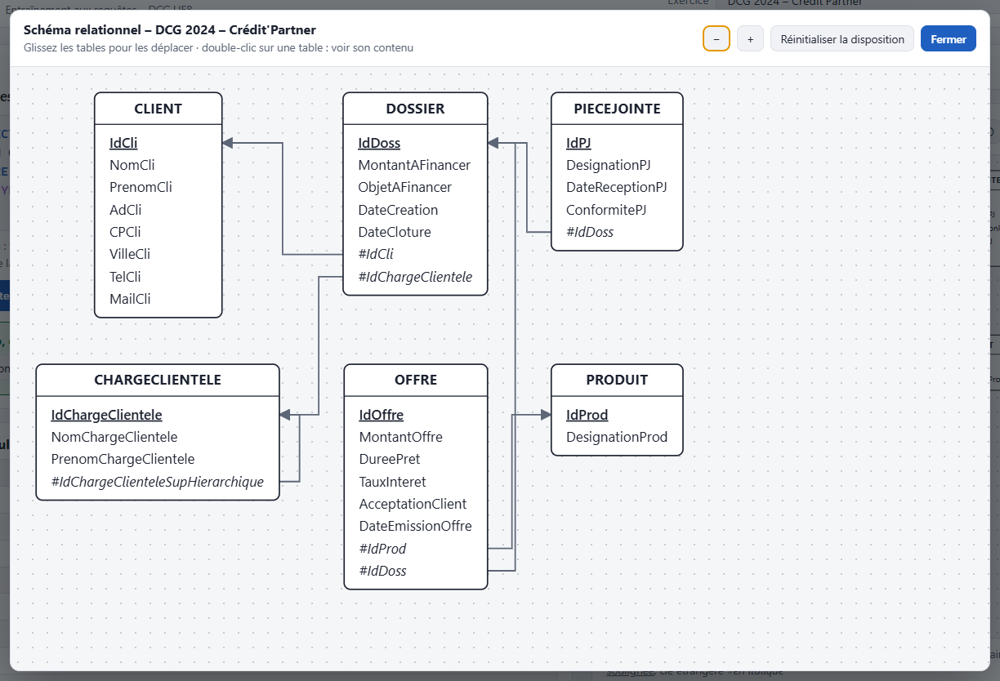
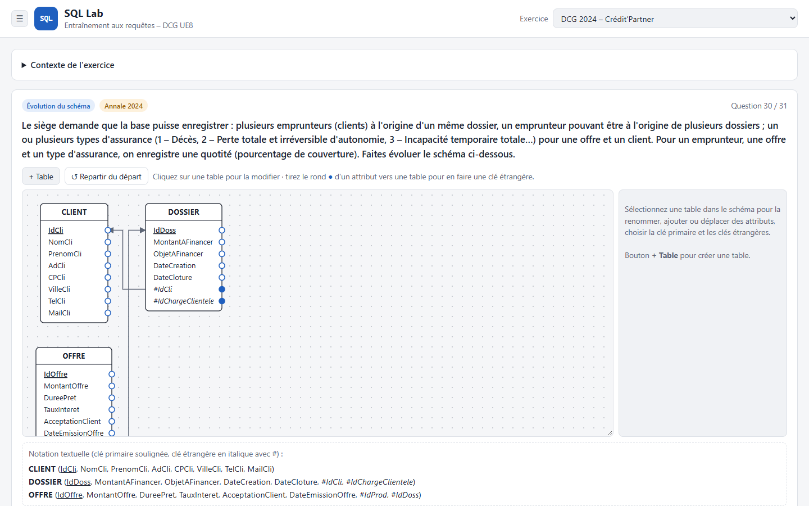

# Schéma relationnel

- Le diagramme suit la notation française : clé primaire soulignée, clé étrangère en italique
  avec #, flèche vers la clé primaire.
- Les tables se déplacent à la souris ou au doigt. Le zoom, la vue en grand et l'onglet de
  notation textuelle sont disponibles.
- **Questions de schéma** : l'étudiant fait évoluer un schéma de départ. La vérification compare
  la *structure* : tables, clés, références, attributs à retirer. Les noms équivalents sont
  acceptés, et une table est reconnue à sa clé primaire.

